# 钥匣 · KeyCoffer

<div align="center">

**一个本地加密的小保险箱：动态验证码 + 账号密码 + 密钥笔记，全放在一个列表里**

## 👉 <https://andhirtion.github.io/TokenVault/> 👈

60 个平台（含 20 个国内） · 折叠搜索选平台 · 主界面先选后进 · 自定义图标 · 指纹优先进入 · WebDAV 云备份 · AES-256-GCM 本地加密

<br>


</div>

---

## 目录

- [一、三种用法](#一三种用法)
- [二、界面](#二界面)
- [三、三种条目](#三三种条目)
- [四、功能](#四功能)
- [五、怎么把已有令牌搬进来](#五怎么把已有令牌搬进来)
- [六、支持的平台](#六支持的平台)
- [七、安全设计](#七安全设计)
- [八、常见问题](#八常见问题)
- [九、自检与开发](#九自检与开发)
- [十、目录结构](#十目录结构)

---

## 一、三种用法

| 方式 | 地址 / 文件 | 大小 | 适合 |
| --- | --- | --- | --- |
| **① 在线网页版** | <https://andhirtion.github.io/TokenVault/> | 0 安装 | **手机浏览器打开就用**，菜单里「添加到主屏幕」就像个 App，断网也能出码 |
| **② 安卓 App** | [TokenVault-1.3.0.apk](https://github.com/andhirtion/TokenVault/releases/download/v1.3.0/TokenVault-1.3.0.apk) | 2.4 MB | 想要原生体验（真机相机扫码、内置浏览器抓密钥、系统指纹） |
| **③ 本地跑源码** | [`web/`](web/) 或 [`android/`](android/) | — | 想改代码 |

### ① 在线网页版（最快，推荐先试这个）

手机或电脑浏览器打开 <https://andhirtion.github.io/TokenVault/>：

1. 首次进入设置 6 位 PIN → 再输一次确认；
2. 点右下角 **＋** 添加条目，或点右上角 **「获取」** 从二维码 / 图片 / 剪贴板导入；
3. 想用指纹：设置 → 安全 → 打开「指纹 / 面容解锁」，验一次系统指纹就绑好了。之后每次打开先弹指纹，按一下就进；
4. 浏览器菜单 →「添加到主屏幕 / 安装应用」，之后全屏打开、离线可用。

> 内容加密后存在**你浏览器的 IndexedDB** 里，GitHub Pages 只托管静态文件，
> 没有任何后端接口，密钥、验证码、密码都不会离开设备。

### ② 安卓 App

| 文件 | 大小 | 说明 |
| --- | --- | --- |
| [TokenVault-1.3.0.apk](https://github.com/andhirtion/TokenVault/releases/download/v1.3.0/TokenVault-1.3.0.apk) | 2.4 MB | 正式包，包名 `com.yg.tokenvault`，R8 混淆 |
| [TokenVault-1.3.0-debug.apk](https://github.com/andhirtion/TokenVault/releases/download/v1.3.0/TokenVault-1.3.0-debug.apk) | 21 MB | 未混淆版，包名 `com.yg.tokenvault.debug`（可与正式包共存），正式包万一闪退就换它 |

传到手机 → 点开 → 允许「安装未知来源应用」→ 装完打开。
（全部版本见 [Releases](https://github.com/andhirtion/TokenVault/releases)。）

- 要求 **Android 8.0（API 26）** 及以上；指纹解锁需要设备有可用的生物识别硬件并录入过指纹
- debug 证书签名，上不了 Play 商店，自己用没问题
- 装之前先联网同步一次系统时间 —— TOTP 严格依赖时间

### ③ 本地跑源码

```bash
cd TokenVault
python tools/serve.py 8777     # 必须是它，不能用 python -m http.server（原因见下）
```

打开 <http://127.0.0.1:8777/index.html>，手机连同一 WiFi 用 `http://<电脑IP>:8777/index.html`。

> 用 `127.0.0.1` 时浏览器会把 WebAuthn 的 RP ID 当成无效域，指纹开启会报
> `SecurityError: This is an invalid domain` —— 本地测指纹请用 `localhost`，
> 线上 GitHub Pages 是 HTTPS 域名，没这个问题。

> Windows 注册表常把 `.js` 映射成 `text/plain`，Service Worker 会因此注册失败、离线缓存失效
> （控制台报 `unsupported MIME type ('text/plain')`）。`tools/serve.py` 强制返回
> `text/javascript` 并加了 `Service-Worker-Allowed: /`。

安卓端：

```bash
bash tools/build_apk.sh            # debug 包
bash tools/build_apk.sh release    # 正式包
bash tools/build_apk.sh test       # 跑 33 项 JVM 单元测试
```

`.toolchain/` 已备好 **JDK 17 + Android SDK Platform 35 + Build-Tools 35.0.0 + Gradle 8.11.1**，
脚本自己设 `JAVA_HOME` / `ANDROID_HOME` / `GRADLE_USER_HOME` / 临时目录，不污染系统。
国内 `dl.google.com` 常不通，所以 `settings.gradle.kts` 把**阿里云 Maven 镜像排在官方源前面**。

---

## 二、界面

<div align="center">


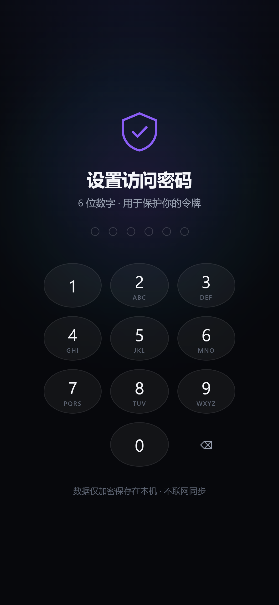
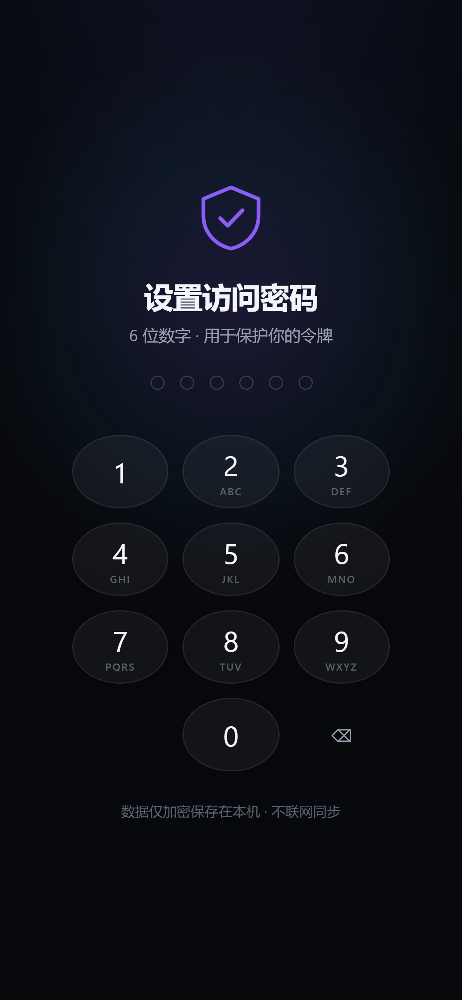
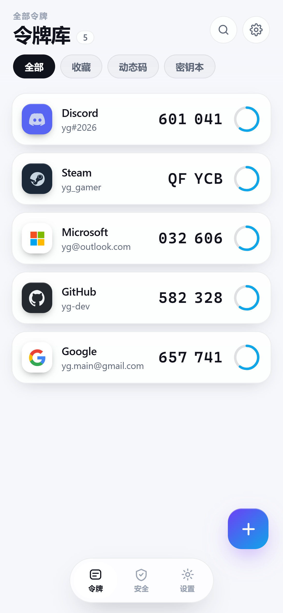

<sub>**主界面（首屏）**：先选入口再解锁，不点就不加载 app.js · 进入后的保险箱 · PIN 锁屏 · 浅色主题</sub>

</div>

<div align="center">

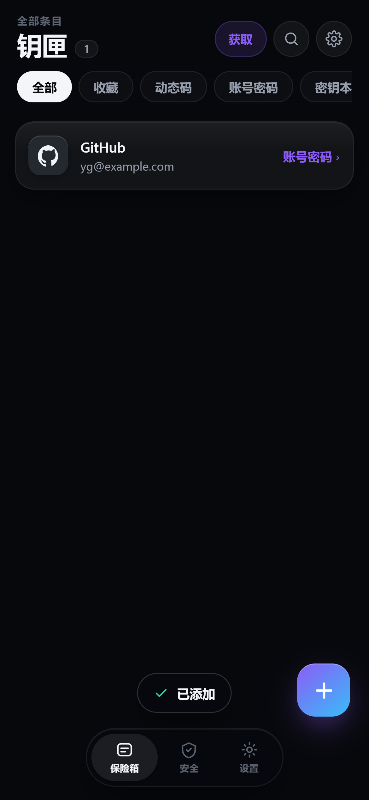
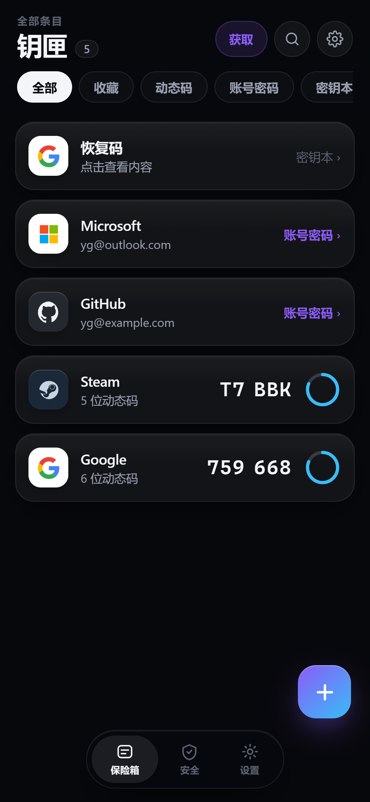
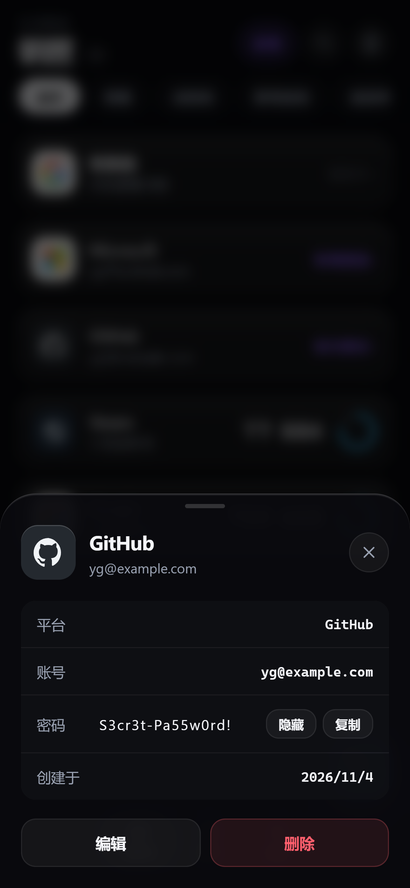
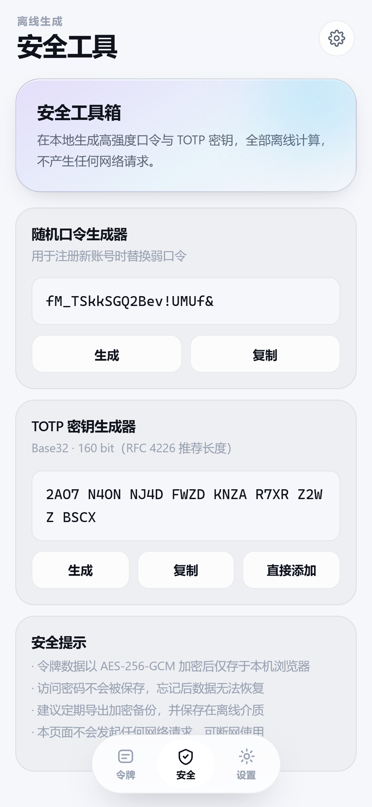

<sub>「账号密码」筛选项 · 验证码 / 账号密码 / 密钥笔记混在一个列表 · 密码默认打码，可展开可复制 · 安全工具</sub>

</div>

<div align="center">

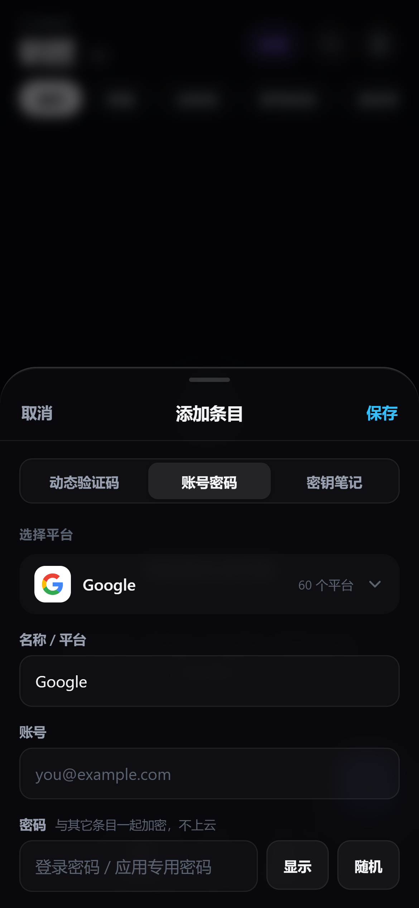
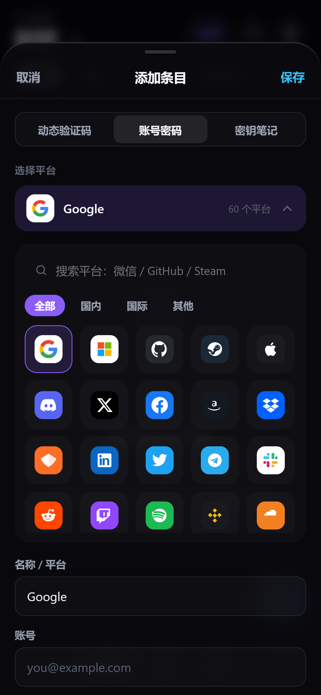
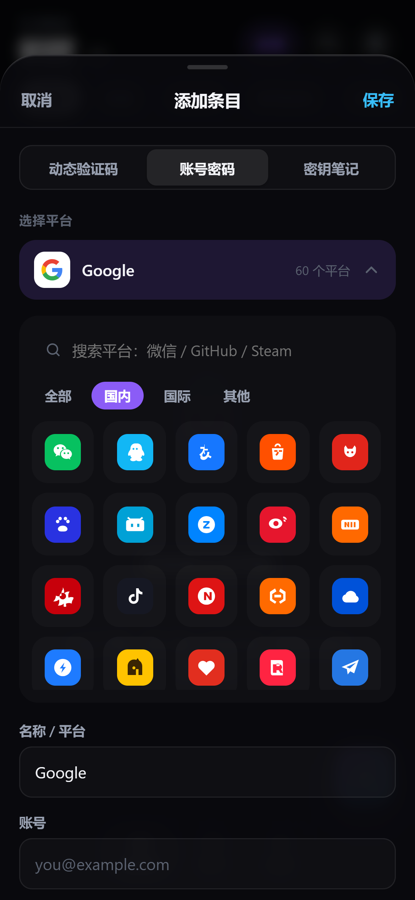


<sub>平台只占一行，点开才展开 · 展开后能搜索、能按国内 / 国际分类 · 20 个国内平台 · **自定义图标**（上传 / 在线抓取）</sub>

</div>

<div align="center">

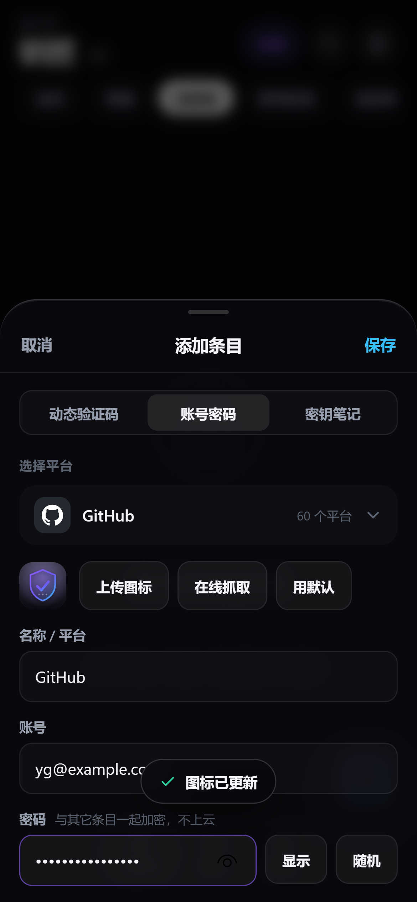
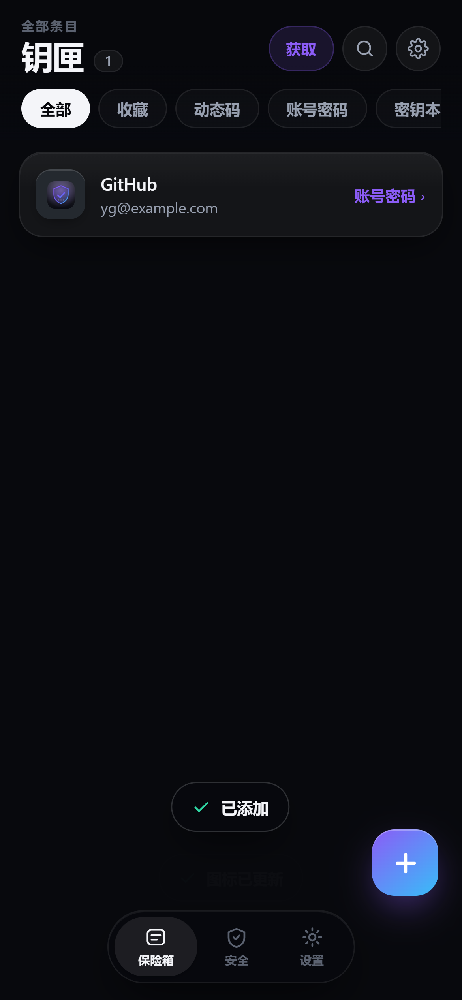


<sub>上传图标后预览实时更新 · 列表与详情都用你的图 · **WebDAV 云端备份**（测试连接 / 立即备份 / 从云端恢复 / 自动备份）</sub>

</div>

<div align="center">

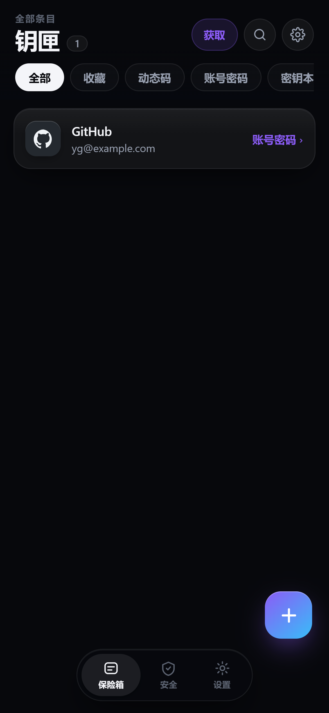
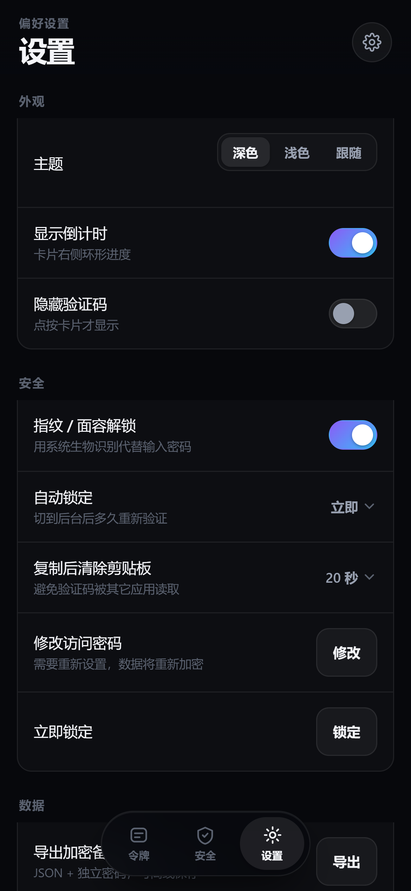
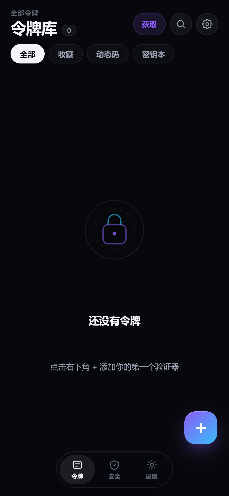

<sub>开了指纹就**先弹指纹**，不用点任何按钮 · 设置里的开关 · 验证通过直接进入</sub>

</div>

- 深色为默认（`#07080c` 底 + 紫青渐变），可切浅色或跟随系统
- **首屏主界面**：四张卡（动态验证码 / 账号密码 / 密钥笔记 / 设置与备份），点哪张进哪块；app.js 按需加载，弱网三秒内也能看到界面，不再白屏转圈
- **60 个平台**的品牌图标（国内 20 + 国际 14 + 原有 26），55 个取自 [Simple Icons](https://simpleicons.org/)（CC0）官方 path，4 个品牌无官方图标的手写，全部内联 SVG / VectorDrawable，**不加载任何网络图片**
- **自定义图标**：添加条目时可以从相册上传一张图（自动裁方缩到 128×128 存进条目），或输入域名在线抓 favicon；随时「用默认」还原
- 环形倒计时，剩 5 秒变红；点验证码即复制，可设 15/30/60 秒后自动清剪贴板
- **指纹优先**：开了生物解锁，锁屏一出现就自动调起指纹，验证通过直接进；浏览器不给无手势调用时，第一次触碰锁屏就立刻补弹；指纹失败或取消才轮到 PIN
- **WebDAV 云端备份**：Nextcloud / Alist / 自建 WebDAV 直连，上传前用 PIN 再加密一层，本地改动 6 秒后自动上传
- 「隐藏验证码」模式：列表只显圆点，点开详情才显示
- 搜索（名称 / 账号 / 备注）+ 类型筛选（全部 / 收藏 / 动态码 / 账号密码 / 密钥本）

---

## 三、三种条目

一个列表装三类东西，靠类型区分行为：

| 类型 | 存什么 | 卡片右侧 | 点卡片 |
| --- | --- | --- | --- |
| **动态验证码** | Base32 密钥 + 算法 / 位数 / 周期 | 6 位（或 8 位）实时验证码 + 环形倒计时 | **直接复制验证码** |
| **账号密码** | 账号 + 密码 + 备注 | 紫色「账号密码 ›」 | 打开详情，密码默认圆点，可展开 / 复制 |
| **密钥笔记** | 一段长文本（API Key、恢复码、两步验证备用码…） | 灰色「密钥本 ›」 | 打开详情看全文 |

为什么要分开：动态验证码要「瞄一眼就能抄」，所以点一下直接复制；密码和密钥不适合随便露在锁屏界面上，
所以走详情页，默认打码。

---

## 四、功能

**动态验证码**
- **60 个平台**的品牌图标与配色，标准 TOTP（SHA-1/256/512，6/8 位，周期可改）
- **Steam Guard 专用 5 位字母码**算法（`23456789BCDFGHJKMNPQRTVWXY`）
- 环形倒计时 + 进度条、剩余时间提示
- 复制验证码、自动清剪贴板
- 收藏、筛选、搜索、隐藏验证码

**平台选择器（折叠 + 搜索）**
- 编辑器里平台只占一行，显示当前平台图标与名称，点一下才展开
- 展开后有搜索框，支持中文、英文、域名三种输入：`微信` / `wechat` / `weixin` 都能命中
- 四枚分类胶囊：全部 / 国内 / 国际 / 其他
- 手填名称或账号时自动猜平台（`yang@outlook.com` → Microsoft、`t.me/xxx` → Telegram、`哔哩哔哩` → bilibili）

**账号密码**
- 密码字段默认打码，右侧「显示 / 隐藏」切换、「复制」一键进剪贴板
- 内置**随机强密码生成**（20 位，大小写 + 数字 + 符号各至少一个，剔除易混淆的 `l I 1 O 0`）
- 账号和密码至少填一项就允许保存（有些老账号只剩密码）
- 和验证码一样参与搜索、收藏、筛选、备份

**获取密钥**（网页版与安卓版都有）
- 相机扫码：对着 `otpauth://` 二维码即入库
- 相册 / 图片识别：截图也能读，纯本地解码
- 剪贴板粘贴：`otpauth://`、`otpauth-migration://`、裸 Base32 都认
- **Google Authenticator 迁移串原生解析**（手写 protobuf，无第三方库），一条链接导入全部账号
- 安卓独有：内置浏览器登录平台 2FA 设置页，自动抓页面里的 otpauth 链接 / 密钥文本 / 二维码图片
  （内置站点含 Google、Microsoft、GitHub、Steam、Dropbox、Amazon、Epic、Discord、**Telegram 网页版**、X）
- 安卓独有：浏览器里点 `otpauth://` 链接直接跳进 App 导入

**安全**
- **指纹 / 面容解锁（当 PIN 用，且优先于 PIN）**：验证一次系统生物识别就直接进入，不用输 PIN
- PIN 经 **PBKDF2-HMAC-SHA256（250,000 次迭代）** 派生 256 位密钥
- 三类条目（验证码 / 密码 / 笔记）用同一把 **AES-256-GCM** 主密钥加密落盘，密文被改即解不开
- 换 PIN 重新生成随机盐、整体重加密（同时作废已绑定的指纹）
- 自动锁定（1/3/5 分钟，切后台开始计时）、立即锁定清空内存密钥
- 系统备份 / 设备迁移全部排除，密钥不会被云备份带走
- **数据从不上传**：无服务端，加密解密与验证码计算全在本机

**数据**
- 导出 AES-256-GCM 加密备份（独立密码，可放网盘）——三类条目都在里面
- 导入加密备份，或一批 `otpauth://` 文本批量导入

**工具页**
- 随机口令生成器（8–48 位，大小写 / 数字 / 符号开关）
- Base32 密钥生成（给其它验证器用）
- 验证码试算（不保存，临时核对某密钥算得对不对）

---

## 五、怎么把已有令牌搬进来

点列表页右上角 **「获取」**（或工具箱第一张卡）；想用内置浏览器自己抓密钥的，点主界面顶栏的 🌐：

<div align="center">
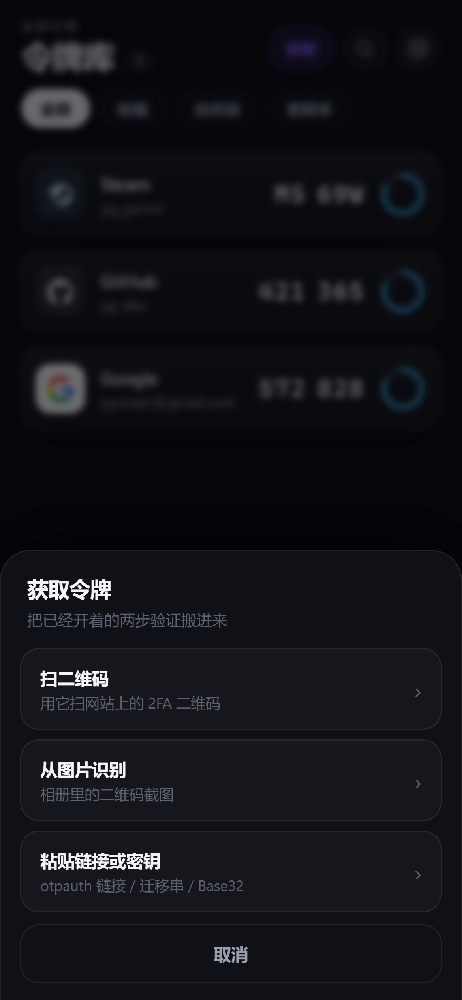
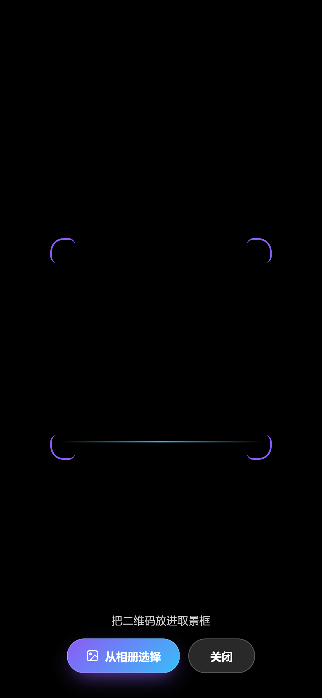
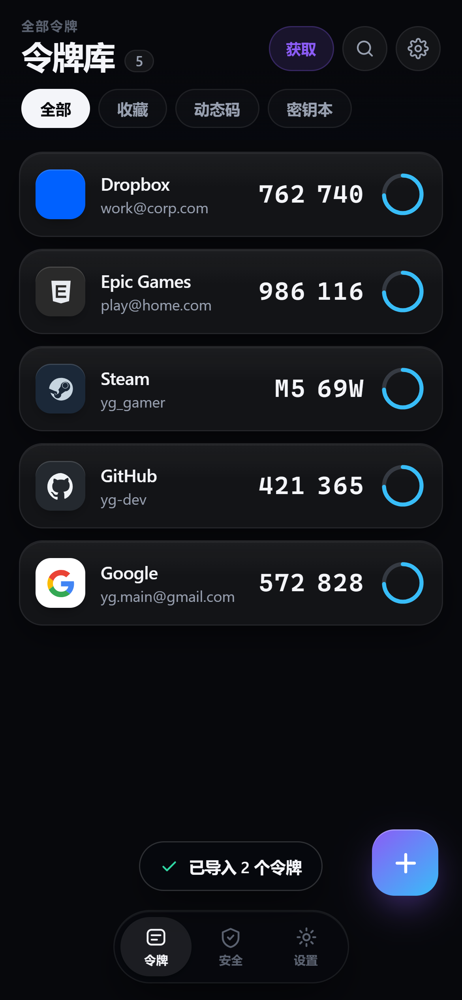
</div>

| 方式 | 适用场景 | 怎么做 |
| --- | --- | --- |
| **扫二维码** | 正在给某账号开启两步验证 | 网站显示二维码时对准它，一秒入库，平台 / 账号 / 参数全自动填好。**扫码界面底部还有「从相册选择」**，懒得多点一步就直接从截图选 |
| **从图片识别** | 二维码已经截图存相册 | 选图片，本地解码，不传任何图像 |
| **粘贴链接或密钥** | 手上有 `otpauth://` 链接 / 迁移串 / Base32 | 复制后点这一项，自动拆出平台、账号、算法、位数、周期 |

> **安卓的「在应用内登录抓密钥」不在导入面板里了**，入口移到了主界面顶栏 —— 那个 🌐 地球图标就是。
> 点它打开内置浏览器，选平台（Google / 微软 / GitHub / Steam / Dropbox / Amazon / Epic / Discord / Telegram 网页版），
> 正常登录走到 2FA 设置页，页面上的二维码和密钥文本会被自动识别，底部出现「已捕获 N 条密钥 → 全部导入」。
> 之所以挪出来：它属于「自己动手抓」，和「把已有的搬进来」是两件事，混在一个弹窗里容易看错。

> **为什么不能"事后读回"已经开着的 2FA 密钥？**
> 这是各平台自己的限制：Google / 微软 / GitHub 的安全设置里只会显示「已开启」，密钥在开启那一刻
> 之后就不再展示（GitHub 只在 setup 页给一次 secret；Steam 要走官方手机令牌流程）。
> 任何验证器（含 Authy、1Password）都拿不到「事后读取」，只能在那一次 setup 时把二维码/密钥抄下来。
> 本应用做的是把这一步省到最少：**扫码，或在 App 内登录后自动抓**。

### 方式 A：Base32 密钥（最通用）

在 Google / GitHub / 微软等安全设置里开启两步验证，选「无法扫描二维码」，网站会给你一串
Base32 密钥（形如 `JBSW Y3DP EHPK 3PXP`）。点 ＋ → 选类型「动态验证码」→ 选平台 → 粘进「密钥」框
（空格、连字符自动清理）→ 保存。

### 方式 B：otpauth 链接

形如 `otpauth://totp/GitHub:me@mail.com?secret=XXXX&issuer=GitHub&digits=6&period=30`
的链接可以粘进来批量导入（多行也行）。安卓版还注册了 `otpauth` 与 `otpauth-migration`
两个 scheme，浏览器里点这种链接会直接跳进 App。

### 方式 C：从别的验证器迁移

Google Authenticator「导出账号」生成
`otpauth-migration://offline?data=<base64>`，本应用**原生解析这个 protobuf**，一条链接导入全部令牌
（含 issuer、账号、算法、位数）。Authy / Aegis / 2FAS 支持导出明文 `otpauth://` 列表的，直接粘贴也行。

### 方式 D：账号密码 / 笔记手输

- **账号密码**：点 ＋ → 类型选「账号密码」→ 平台（可留自定义）→ 账号 → 密码（可点「随机」生成一个强密码）。
  保存后卡片刻意不显示密码，只显示账号。
- **密钥笔记**：点 ＋ → 类型选「密钥笔记」→ 标题 → 正文。适合存 API Key、恢复码、两步验证备用码、
  银行卡信息之外的短文本备忘。

> Steam 密钥通过 Steam 手机令牌的「添加验证器」流程给出。Steam 用 5 位字母码，
> 本应用自动按 Steam 规则生成，不需要改任何参数。

---

## 六、支持的平台

**60 个**，编辑器里按「全部 / 国内 / 国际 / 其他」分类，也能直接搜。

**国内 20 个**：微信 · QQ · 支付宝 · 淘宝 · 京东 · 百度 · 哔哩哔哩 · 知乎 · 微博 · 小米 · 华为 ·
抖音 · 网易 · 阿里云 · 腾讯云 · 钉钉 · 美团 · 拼多多 · 小红书 · 携程

**国际 14 个**：PayPal · Netflix · Stripe · Vercel · DigitalOcean · Bitwarden · 1Password ·
任天堂 · PlayStation · 战网 · Roblox · Zoom · Figma · OpenAI

**原有 26 个**：Google · Microsoft · GitHub · **Steam** · Apple · Discord · X (Twitter) · Amazon ·
Dropbox · Facebook · GitLab · LinkedIn · Slack · Telegram · Reddit · Twitch · Spotify · Binance ·
Cloudflare · Notion · Proton · Epic Games · Instagram · Xbox · Twitter · 自定义

平台识别带别名表，中英文都认：`Gmail` → Google、`Outlook/Hotmail/Office 365/Azure` → Microsoft、
`iCloud` → Apple、`AWS` → Amazon、`t.me / web.telegram.org` → **Telegram**、
`微信 / weixin` → 微信、`哔哩 / b站` → 哔哩哔哩、`tiktok / 字节` → 抖音、
`chatgpt / anthropic / claude` → OpenAI、`战网 / blizzard / 暴雪` → 战网。
手填名称时也会自动猜平台：名称或账号里出现 `github` 就落到 GitHub，出现 `steam` 就落到 Steam，
出现 `小米账号` 就落到小米，不用先去点图标。不认识的 issuer 一律落到「自定义」，照样能用。

**图标全在手边**：60 套品牌图形都是手写内联 SVG（网页）与 VectorDrawable（安卓），网页侧
`tools/export_icons.py` 从 web 的 `ICONS` 表自动转出安卓资源，两端永远是同一套图，不加载任何网络图片。

---

## 七、安全设计

| 环节 | 做法 |
| --- | --- |
| 密钥派生 | PBKDF2-HMAC-SHA256，250,000 次迭代，随机 32 字节盐 |
| 加密 | AES-256-GCM，96 位随机 IV，128 位认证标签 |
| 存储 | Web：IndexedDB；安卓：SharedPreferences（两者都只存密文） |
| 覆盖范围 | 验证码密钥、账号、密码、笔记正文**全部在密文里**，明文只在解锁后的内存中 |
| 换 PIN | 新盐 + 全量重加密；已绑定的指纹同步作废，需要重新开启 |
| 密码显示 | 详情页默认圆点；只有点「显示」才临时渲染明文，锁屏或切后台即清 |
| 备份 | 独立密码再加密一次，明文永不落盘 |
| WebDAV 云备份 | 上传的 `payload` 与本地库同构（PBKDF2 + AES-256-GCM），凭证只在本机 `localStorage`；服务器只见到密文文件名与字节数；连接走 `fetch` + Basic 认证，不含任何中转服务 |
| 自定义图标 | 只在你本机做 `canvas` 裁切缩放后存进条目；「在线抓取」只请求你填的那个域名的 favicon，请求不带任何条目数据 |
| 系统备份 | 安卓 `allowBackup=false` + `dataExtractionRules` 全排除 |
| 生物解锁（安卓） | `AndroidKeyStore` 里一把「每次使用都需认证」的 AES-256-GCM 密钥封住 PIN（`setUserAuthenticationRequired` + `setInvalidatedByBiometricEnrollment`），密钥不出安全区，新增/删除指纹即失效 |
| 生物解锁（网页） | WebAuthn platform authenticator；支持 PRF 时包裹密钥不落盘，不支持时用本机随机密钥包裹 —— 属便利层，等价于把 PIN 加密存在本机 |
| 网络 | Web 版：主界面与本地使用零请求；只有你主动点「在线抓取图标」或配置 WebDAV 备份时才联网。安卓 `INTERNET` 权限只服务于内置浏览器登录页 |

**没有找回通道。** 忘了 PIN 只能靠之前导出的加密备份 —— 能找回就等于别人也能找回。

---

## 八、常见问题

**验证码一直不对？**
1. 系统时间有没有自动同步（TOTP 误差超过 30 秒必错）；
2. 密钥有没有抄漏 —— 本应用会把 `0` 当 `O`、`1` 当 `L` 容错，但漏字符救不了；
3. 平台选错没有（Steam 必须选 Steam，普通 6 位算法算不出它的 5 位码）。

**账号密码该存哪一类，密码条目还是密钥笔记？**
要「账号 + 密码」成对存、想用显示/复制/随机生成的，选**账号密码**；
只是贴一段文本（API Key、恢复码、备用码），选**密钥笔记**。两者加密强度一样，区别只在界面。

**指纹和 PIN 谁优先？**
开了「指纹 / 面容解锁」就**指纹优先**，PIN 只是兜底：
- 锁屏一出现就自动调起系统指纹，验证通过直接进，不用点任何东西；
- 安卓端会等窗口真正拿到焦点（约 0.65 秒）再弹，否则系统会静默丢弃这次认证；
- 浏览器不允许无手势调用 WebAuthn（`NotAllowedError`）时，会自动布防 —— 你第一次触碰锁屏（点、滑、按键任一下）
  立刻补弹指纹，仍然不用去按指纹按钮；
- 指纹没通过、被取消，或者设备取消/新增了录入的指纹（`KeyPermanentlyInvalidatedException`），
  就退回输 PIN —— 此时指纹绑定会被自动清掉，进设置页重新开启即可。

**指纹是不是把密码明文存手机里了？**
安卓端存的是被 AndroidKeyStore 硬件密钥封住的密文，那把密钥要求每次使用都做一次生物认证，
且新增/删除指纹会让它永久失效。网页端 WebAuthn 会记录一个本机凭证，再用它包裹 PIN 密文；
浏览器不支持 PRF 扩展时，包裹密钥只能落在本机存储里 —— 所以文档里写明这是**便利层**，不是额外加密层。

**换手机怎么办？**
设置 → 导出加密备份，把文本存网盘；新机导入。别指望系统备份 —— 本应用主动排除了它。

**忘了 PIN？**
只能靠加密备份恢复。请务必先导出一份。

**能不能云端同步？**
只有 **WebDAV 备份**（见下一节），而且它只做「整库加密覆盖上传」，不做多端合并同步 ——
两台设备各存一份，谁后上传谁覆盖，冲突时靠导出的本地文件回滚。真正的多端同步要有人做冲突合并，
那是另一个工程，也是本应用刻意不碰的部分。

### WebDAV 云端备份怎么配

设置 → **WebDAV 云端备份**，四个字段：

| 字段 | 举例（Nextcloud） | 说明 |
| --- | --- | --- |
| 服务器地址 | `https://cloud.example.com/remote.php/dav/files/你的用户名/` | 末尾斜杠可有可无，不写 `https://` 会自动补 |
| 账号 | `yourname` | |
| 密码 / 应用密码 | `xxxxx-xxxxx-xxxxx` | Nextcloud / 坚果云建议用「应用专用密码」，不要用登录密码 |
| 远程文件路径 | `KeyCoffer/backup.json` | 目录不存在会自动 `MKCOL` 建出来 |

「备份加密密码」留空就用**本次解锁的 PIN**。点「测试连接」先验一遍（走 `PROPFIND`），
401/403 说明账号密码不对，`Failed to fetch` 说明**服务器没放行跨域（CORS）**：

- **能直连的**：Nextcloud（装 `Access-Control-Allow-Origin` 或同源）、Alist、rclone serve webdav、自建 Nginx 加 CORS 头；
- **会被浏览器拦的**：坚果云（默认不放行）、部分只给客户端用的 WebDAV 服务。
- 打开「自动备份」后，本地任何改动 **6 秒后自动上传一次**（防抖，避免边打字边传）。

上传的文件长这样（外面一层是 WebDAV 传输，里面这层才是真加密）：

```json
{ "app": "TokenVault", "version": 1, "exportedAt": 1762300000000, "count": 12,
  "payload": { "v": 1, "alg": "AES-256-GCM", "salt": "…", "iv": "…", "ct": "…" } }
```

`payload` 是用你的 PIN 派生的密钥加密的，**服务器管理员拿到文件也解不开**。

**网页版扫码没反应？**
`BarcodeDetector` 只有 Chrome / Edge 新版和部分 Safari 支持。不支持时点「扫二维码」会自动改为
**从相册选图**；再不行就用「粘贴链接或密钥」。

**内置浏览器抓不到密钥？**（安卓，入口在主界面顶栏的 🌐 图标）
1. 要走到 **2FA 设置页**，不是登录页或首页 —— 密钥只在这个页面出现；
2. 平台在已开启状态下只显示「已启用」，不给密钥。只能先移除再重新开启，在重开那一次扫；
3. 抓取每 1.8 秒扫一次页面，页面加载慢就多点几次右上角「抓取」。

**平台太多了不好找？**
编辑器里的平台栏默认折叠成一行，点开才有网格。展开后：
- 上方搜索框支持中文、英文、域名 —— `微信`、`wechat`、`weixin` 都能命中；搜 `云` 会同时出阿里云和腾讯云；
- 四枚胶囊切「全部 / 国内 / 国际 / 其他」，国内 20 个一眼扫完；
- 干脆不选也行，直接填名称或账号，保存时会自动猜到平台。

**Telegram（网页版 / 频道）怎么存？**
Telegram 的两步验证是**自设密码**，不是 TOTP 动态码，没有二维码可扫。做法：新建一条
**「账号密码」**条目 → 平台选 Telegram → 账号填手机号或 `@频道名` → 密码填两步验证密码，
备注里写恢复邮箱 / 备用码。如果你自己的某个服务（如自建 Telegram Bot 面板）给了 TOTP 二维码，
照常扫码即入库，平台会自动归到 Telegram。安卓版内置浏览器的站点列表里已包含 `web.telegram.org`
（主界面顶栏 🌐 进入）。

**为什么包里还叫 `com.yg.tokenvault`、仓库还叫 TokenVault？**
改名只改了显示名称。包名一改就是另一个应用，旧数据、旧指纹绑定、已导出的备份全对不上；
仓库名一改，在线地址和所有已发出去的链接全部失效。所以对外叫**钥匣**，标识保持原样。

---

## 九、自检与开发

```bash
node tools/verify.js             # Web 版算法（30 项）
node tools/verify_web_import.js  # Web 版「获取令牌」解析层（39 项）
bash tools/build_apk.sh test     # 安卓版（33 项 JVM 单元测试）
```

| 覆盖项 | Web 算法 | Web 导入 | 安卓 |
| --- | :---: | :---: | :---: |
| RFC 6238 SHA-1 六组官方向量 | ✅ | — | ✅ |
| RFC 6238 SHA-256 / SHA-512 | ✅ | ✅ | ✅ |
| 6 位 / 8 位 / 前导零补位 | ✅ | — | ✅ |
| Steam 5 位字母码字符集 | ✅ | ✅ | ✅ |
| Base32 容错（大小写/空格/0→O/1→L） | ✅ | ✅ | ✅ |
| 过短密钥拒绝 | ✅ | ✅ | ✅ |
| 剩余时间与进度 | ✅ | — | ✅ |
| 随机密码：长度 / 字符类 / 无混淆字符 / 不重复 | — | — | ✅ |
| 随机密码：荒谬长度夹取（8–64） | — | — | ✅ |
| `otpauth://` 解析（Google/GitHub/Steam/自定义） | ✅ | ✅ | ✅ |
| `otpauth-migration://` protobuf（多账号/SHA256/8 位/跳过 HOTP） | — | ✅ | ✅ |
| 混合文本识别与按 secret 去重 | — | ✅ | ✅ |
| HTML 实体反转义、垃圾文本拒绝 | — | ✅ | ✅ |
| 平台别名识别、单字符 key 不误判 | — | ✅ | ✅ |
| 60 平台默认参数合法性 / 分类合法（cn·intl·other） | — | ✅ | ✅ |
| 平台搜索：中文别名命中（`微信`→wechat）、分类过滤（`国内=20`） | — | — | ✅ |
| WebCrypto 与纯 JS 实现交叉验证 | ✅ | — | — |

**当前结果：Web 算法 30 + Web 导入 39 + 安卓 33 = 102 项，全部通过 / 0 失败。**

界面回归（需先起 `python tools/serve.py 8777`，用本机 Edge）：

```bash
python tools/shoot.py        # 锁屏 / 列表 / 详情 / 编辑器 / 设置 / 工具箱 / 浅色
python tools/shoot_grab.py   # 「获取」面板 + 迁移串导入全流程
python tools/shoot_scan.py   # 扫码层（含「从相册选择」，用 fake camera）
python tools/shoot_login.py  # 账号密码条目（增 / 列表 / 详情 / 重载自动指纹）
python tools/shoot_v12.py    # 三类条目混合列表 / 密码详情 / 密码编辑器
python tools/shoot_v121.py   # 平台折叠 + 搜索 + 分类 + 指纹优先冷启动（CDP 虚拟认证器）
python tools/shoot_bio.py    # 指纹开启 + 指纹解锁全流程（CDP 虚拟认证器）
python tools/shoot_v13.py    # 国内平台列表（微信 / 支付宝 / 哔哩哔哩 / 京东）
python tools/shoot_v14.py    # 主界面 → 进入 → 自定义图标上传 → 列表图标 → WebDAV 设置页
```

图标与素材脚本：

```bash
python tools/fetch_icons.py  # 从 Simple Icons（CC0）拉 55 个官方品牌 path，重写 web/app.js 的 ICONS
python tools/export_icons.py # 把 web/app.js 的内联 SVG 转成安卓 VectorDrawable（60 个图标）
python tools/fix_icon_fill.py # 单色图标 fill 改 currentColor，避免同色底上看不见
```

---

## 十、目录结构

```
TokenVault/
├─ docs/                      # GitHub Pages 发布副本（= web/，改完 cp -r web docs）
├─ dist/                      # 成品 APK
├─ web/                       # PWA，零依赖零构建
│  ├─ index.html
│  ├─ styles.css              # 设计系统：深色 #07080c / 紫青渐变
│  ├─ app.js                  # TOTP 算法 + AES-GCM 保险库 + 导入解析 + WebAuthn + 全部交互
│  ├─ sw.js                   # Service Worker：逐个缓存 + network-first 超时回退（缓存 keycoffer-v2）
│  ├─ manifest.webmanifest
│  └─ icon.svg
├─ android/
│  ├─ app/src/main/java/com/yg/tokenvault/
│  │  ├─ data/                # Platforms / TokenEntry（CODE·LOGIN·NOTE）
│  │  │                       # + Totp / VaultRepository / OtpImporter / OtpMigration
│  │  ├─ security/            # VaultCrypto（PBKDF2 + AES-GCM）/ BiometricVault（指纹封 PIN）
│  │  ├─ util/                # Base32 / QrDecoder（zxing 封装）/ PasswordGen（随机强密码）
│  │  ├─ ui/theme/            # 配色、字体、深浅主题
│  │  ├─ ui/components/       # BrandTile / TokenCard / RingProgress / PinPad / AppLogo
│  │  ├─ ui/screens/          # Lock / Vault / Editor / Detail / Settings / Tools
│  │  │                       # + ImportSheet（三选一）/ ScanScreen（CameraX 扫码）
│  │  │                       # + LoginScreen（内置浏览器登录抓取，入口在主界面顶栏）
│  │  ├─ VaultViewModel.kt    # 含 sessionPin、类型筛选、密码生成
│  │  ├─ TokenVaultApp.kt     # 含指纹优先自动唤起
│  │  └─ MainActivity.kt      # FragmentActivity（BiometricPrompt 宿主）+ otpauth:// 外链导入
│  ├─ app/src/test/java/com/yg/tokenvault/   # CoreLogicTest 21 项 + OtpImportTest 12 项
│  └─ app/src/main/res/       # 60 套品牌图标、自适应启动图标、字符串、备份排除规则
├─ tools/
│  ├─ serve.py                # 带正确 MIME 的本地服务器
│  ├─ verify.js               # Web 版算法自检
│  ├─ verify_web_import.js    # Web 版导入解析自检（自带 protobuf 编码器）
│  ├─ build_apk.sh            # 一键编译 / 跑测试（自带工具链）
│  ├─ export_icons.py         # 从 web/app.js 的品牌 SVG 生成安卓 VectorDrawable
│  ├─ fix_icon_fill.py        # 单色图标统一改 currentColor（避免同色底上看不见）
│  ├─ shoot.py                # 界面截图
│  ├─ shoot_grab.py           # 「获取令牌」流程截图
│  ├─ shoot_scan.py           # 扫码层截图（fake camera）
│  ├─ shoot_login.py          # 账号密码条目截图
│  ├─ shoot_v12.py            # 三类条目混合截图
│  ├─ shoot_v121.py           # 平台折叠 / 搜索 / 分类 / 指纹优先冷启动
│  ├─ shoot_v13.py            # 国内平台列表截图
│  ├─ shoot_v14.py            # 主界面 / 自定义图标 / WebDAV 设置页截图
│  ├─ fetch_icons.py          # 从 Simple Icons（CC0）拉官方品牌 path 重写 ICONS
│  ├─ shoot_bio.py            # 指纹流程截图（CDP 虚拟认证器）
│  └─ dbg_bio.py              # 指纹调试脚本
├─ shots/                     # README 与验收用截图
└─ .toolchain/                # 自带 JDK17 + SDK35 + Gradle 8.11.1（不进版本库）
```

---

## 更新日志

**v1.4.0** — 网页端大改造（安卓端不出新包，功能不变）：

- **新增主界面（首屏）**：打开先看到四张大卡（动态验证码 / 账号密码 / 密钥笔记 / 设置与备份），
  **点哪张才加载 app.js 并进哪块**。以前是一进来就同步拉 `app.js` 再解锁，弱网会长时间白屏转圈；
  现在首屏是内联 HTML + CSS，不依赖任何 JS 文件，离线也能立刻出来；
- **Service Worker 重写**：缓存从 `addAll` 改为逐个 `add` 且每个都 try/catch（原来任一文件失败就整体失败，
  导致反复重装、白屏），导航与 `app.js` 走 network-first + 2.6s / 4s 超时回退缓存，其余仍缓存优先；
- **图标全部纠错**：55 个品牌换成 [Simple Icons](https://simpleicons.org/)（CC0）官方 path，
  4 个没有官方图标的（京东 / 腾讯云 / 钉钉 / 拼多多）手写；单色图标统一 `currentColor`，
  修掉 v1.3.0 里「一半图标显示成纯色方块」的问题；
- **自定义图标**：添加 / 编辑条目时可以**上传本地图片**（自动居中裁方、缩到 128×128、存进条目），
  或**输入域名在线抓 favicon**（DuckDuckGo → Google S2 → `/favicon.ico` 三路依次试），
  随时「用默认」还原成平台图标；
- **WebDAV 云端备份**：设置里填服务器 / 账号 / 应用密码 / 远程路径，支持测试连接（PROPFIND）、
  立即备份（PUT）、从云端恢复（GET）、6 秒防抖自动备份；上传内容用 PIN 再加密一层（AES-256-GCM），
  服务器端只看到密文。同时保留原来的本地文件导出 / 导入；
- **UI 打磨**：主界面标题分两行不再挤出孤字、四张卡收紧、加「AES-256 本地加密 / 指纹·面容解锁 /
  WebDAV 备份」三枚特性标签；图标行与预览方块对齐；关于页版本号跟上。

自检 30 + 39 项全过（`verify.js` / `verify_web_import.js`）。

**v1.3.0** — 平台从 26 个扩到 **60 个**（新增国内 20 + 国际 14，每套配矢量品牌图标，网页与安卓同源）；
**平台栏改成折叠 + 搜索**：默认只占一行，点开展开网格，支持中英文域名搜索与「全部 / 国内 / 国际 / 其他」分类；
**指纹真正优先**：浏览器无手势被拒后自动布防，第一次触碰锁屏就补弹指纹；安卓等窗口拿到焦点再弹（650ms），
避免系统静默丢弃认证；安卓导入面板去掉「登录账号自动获取」，网页登录入口移到主界面顶栏；
修掉平台网格里一半图标显示成纯色方块（单色 glyph 统一用前景色渲染）。自检 102 项全过。

**v1.2.0** — 加入**账号密码**条目类型（密码打码显示、一键复制、内置 20 位随机强密码生成）；
**指纹优先**：开启生物解锁后锁屏自动调起指纹，通过即进，失败才退回 PIN；
品牌更名 **钥匣 · KeyCoffer**（包名与仓库名保持不变，见 FAQ）；列表按类型筛选（动态码 / 账号密码 / 密钥本）；
README 重写。自检 102 项全过。

**v1.1.3** — 新增**指纹 / 面容解锁**（指纹当 PIN 用）：网页版走 WebAuthn、安卓走 BiometricPrompt + AndroidKeyStore；Telegram 网页版 / 频道链接（`t.me`）加入平台识别与内置登录站点。

**v1.1.2** — 扫码取景层加「从相册选择」（网页版 + 安卓版同步）；网页版摄像头不可用或被拒时自动降级到相册；README 重写并配上 10 张界面截图。

**v1.1.1** — 网页版上线 <https://andhirtion.github.io/TokenVault/>；网页版支持扫码 / 图片 / 粘贴 /
Google 迁移串导入；扫码界面加「从相册选择」；修平台别名与单字符 key 误判；修弹层透光。

**v1.1.0** — 安卓版四条自动获取密钥通道（扫码 / 登录抓取 / 相册 / 剪贴板）、迁移串原生解析、
外链导入、`INTERNET` 权限。

**v1.0.0** — Web PWA + 安卓 App 首发，26 平台、Steam 5 位码、AES-256-GCM 本地保险库。

---

<div align="center">
<sub>Made for people who are tired of pulling out their phone for a 6-digit number.</sub>
</div>