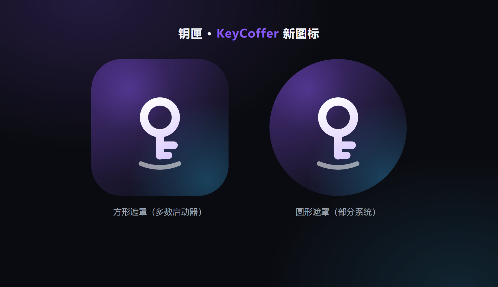

# 钥匣 · KeyCoffer

<div align="center">

**一个只存在你手机里的小保险箱：动态验证码、账号密码、密钥笔记，同一个列表里放**


### 👉 [下载 App（v1.7.3 · 2.4 MB）](https://github.com/andhirtion/TokenVault/releases/latest) 👈

<br>


<br>
<sub>主界面 → 列表 → 编辑器 → 云备份，全部是深色玻璃卡 + 紫青渐变</sub>

<br><br>



<sub>应用图标：深紫渐变底 + 白色钥匙，方形与圆形遮罩都成立</sub>

</div>

---

## 目录

| 章节 | 你会看到 |
| --- | --- |
| [一、下载与安装](#一下载与安装) | 三种装法、签名、包信息、数据存在哪 |
| [二、界面地图](#二界面地图) | 主界面四张卡、列表、详情、锁屏 |
| [三、三种条目](#三三种条目) | 动态码 / 账号密码 / 笔记分别怎么用 |
| [四、功能清单](#四功能清单) | 出码、导入、图标、背景、指纹、检查更新 |
| [五、WebDAV 云备份](#五webdav-云备份) | 怎么配、历史版本、自动备份、排错 |
| [六、安全设计](#六安全设计) | 加密链路、密钥存放、联网行为 |
| [七、常见问题](#七常见问题) | 按症状查：码不对、装不上、指纹不弹 |
| [八、自己构建](#八自己构建) | 环境、命令、单测、签名、脚本 |
| [九、目录结构](#九目录结构) | 哪个文件管哪件事 |
| [更新日志](#更新日志) | 1.0 → 1.7.3 都改了什么 |

---

## 一、下载与安装

| 文件 | 大小 | 说明 |
| --- | --- | --- |
| [TokenVault-1.7.3.apk](https://github.com/andhirtion/TokenVault/releases/download/v1.7.3/TokenVault-1.7.3.apk) | 2.4 MB（2 459 097 字节） | **正式包**，固定签名，可直接覆盖安装旧版 |

SHA-256：`6d49b2a14442360a9e0a63b14be232da829f45cb149ef1c85c4894b580b8d098`

### 装不上就按这个顺序换

1. **直连慢 / 失败** → 换镜像，四个地址装的是同一个包：
   - `https://gh-proxy.com/https://github.com/andhirtion/TokenVault/releases/download/v1.7.3/TokenVault-1.7.3.apk`
   - `https://ghfast.top/https://github.com/andhirtion/TokenVault/releases/download/v1.7.3/TokenVault-1.7.3.apk`
   - `https://ghproxy.net/https://github.com/andhirtion/TokenVault/releases/download/v1.7.3/TokenVault-1.7.3.apk`
2. **提示「签名不一致」** → 装的是 1.3.0 之前的老包。先在设置里导出备份，卸载重装，再导入备份。
3. **提示「未安装应用」/ 被拦截** → 系统设置里给文件管理器或浏览器开「安装未知来源应用」，或先用手机自带文件管理器点一次。

> 包信息：`com.yg.tokenvault` · versionCode 18 · minSdk 26（安卓 8.0）· targetSdk 35
> **不联网也能出码**：INTERNET 权限只用于三件事 —— 检查更新、内置浏览器登录、WebDAV 备份，全部由你主动触发。

### 数据在哪

- 令牌密钥、账号密码、笔记，全部用 **AES-256-GCM** 加密后存在 App 私有目录；
- 加密密钥由你的 **PIN 经 PBKDF2-SHA256（250 000 次）** 派生，只存在于内存；
- 锁屏即清内存密钥；卸载 App 会连数据一起删，**覆盖安装不会**；
- 要换机就配 WebDAV，或设置里「导出加密备份」存成文件。

---

## 二、界面地图

打开先看到主界面，四张卡各进一处：

| 卡片 | 进去是什么 |
| --- | --- |
| **令牌** | 动态验证码列表，点条目看大码 + 复制 + 倒计时环 |
| **账号密码** | 账号 / 密码条目，密码默认打码，点眼睛才显示 |
| **工具箱** | 扫码、相册识别、粘贴导入、随机密钥与密码生成 |
| **设置** | 外观（主题 / 背景）、安全（PIN / 指纹 / 自动锁）、数据（WebDAV / 导入导出）、关于（仓库 / 检查更新） |

底部导航四项与主界面一一对应，任何页面一步可以横跳。返回主界面会锁回去，需要重新验证。

### 列表页


- 顶部筛选胶囊：全部 / 收藏 / 账号密码 / 动态码 / 各平台；
- 右上角三个入口：**地球**（网页登录主页）、**获取**（扫码 / 相册 / 粘贴）、**搜索**；
- 条目右侧是 6 位码与倒计时环（Steam 5 位），点条目进详情；
- 长按条目可以复制当前码，复制后按设置里的秒数自动清空剪贴板。

### 详情页

- 上：品牌图标 + 名称 + 账号；
- 中：超大验证码，点一下复制，剩余时间用环形进度表示；
- 下：密钥（打码，可长按看）、备注、编辑 / 删除。

### 锁屏

首次打开要设 6 位 PIN（连输两次）。之后每次进来先解锁；开了指纹就直接弹系统生物识别。

---

## 三、三种条目

| 类型 | 用来存 | 列表上显示 |
| --- | --- | --- |
| **动态码** | TOTP 密钥（Base32） | 6 位（Steam 5 位）+ 30 秒倒计时环 |
| **账号密码** | 账号、密码、备注 | 账号 + 打码密码，点开可复制 |
| **笔记** | 恢复码、助记词、Wi-Fi 密码之类 | 标题 + 摘要 |

三种混在同一个列表，靠类型标签和筛选胶囊区分。新建时**默认是「自定义」平台**，需要哪个平台现点一下。

---

## 四、功能清单

### 4.1 动态码

- 标准 **RFC 6238 TOTP**：SHA1 / SHA256 / SHA512，6 位或 8 位，周期 15–120 秒；
- **Steam Guard** 单独适配：5 位，字符表 `23456789BCDFGHJKMNPQRTVWXY`；
- 列表到点自动换码，详情页圆环颜色随剩余时间从紫渐变到红；
- 换码时新码淡入上滑，不是硬切。

### 4.2 把已有令牌搬进来（四条通道）

| 通道 | 怎么用 | 能认什么 |
| --- | --- | --- |
| **扫二维码** | 工具箱 → 扫码，对着电脑屏幕 | `otpauth://` 链接、Google 迁移码 |
| **从相册选图** | 扫码页底部「从相册选择」 | 截图里的二维码也能认 |
| **粘贴** | 工具箱 → 粘贴导入 | 链接、裸 Base32、混合文本（一次抓多条） |
| **内置浏览器登录** | 列表右上角地球 → 「网页登录」主页选站点 | 页面上的 `otpauth://`、Base32 串、二维码画布 |

> Google Authenticator 的「导出账号」产出 `otpauth-migration://offline?data=...`，
> App 手写了 protobuf 解析，能一次导入整批（HOTP 会跳过）。

**网页登录主页**只放五个站点：Google、Microsoft、GitHub、Steam、Telegram，下方还有「其它站点」输入框，任何域名都能开。抓取逻辑是：登录后停在「两步验证 / 身份验证器」设置页，脚本每 1.8 秒扫一次页面，发现密钥就通知原生层保存。

### 4.3 自定义图标


编辑器「图标」区两种来源：

- **上传图片**：从相册选，自动居中裁成正方形，最长边不超过 512px 存 PNG（小图不放大，避免糊两次）；
- **联网抓取**：先在「图标域名」栏填站点（`github.com` / `https://mail.qq.com/a?x=1` / `192.168.1.10:8080` 都行），再点按钮，按**分辨率从高到低**试：

  1. 站点自己声明的图标：`apple-touch-icon`、`<link rel="icon" sizes="512x512">`、web app manifest 的 `icons`
  2. 根目录 `apple-touch-icon.png` / `apple-touch-icon-precomposed.png`（常见 180px）
  3. Google s2（256px）与 Clearbit Logo（512px）
  4. DuckDuckGo / `favicon.ico`（16–32px，最后兜底）

- 拿到 ≥192px 提前收工；只抓到小图会直说：「只抓到 32px，放大后会糊，想要清晰就上传图片」；
- 域名栏**留空就是默认图标**，不会去账号里猜；
- 「重置」一键回到默认；填过的域名随条目加密保存。

### 4.4 自定义背景

设置 → 外观 → 自定义背景 → 选图，App 会：最长边压到 1600px 存 JPEG（质量 88）→ 按屏幕尺寸降采样读取防 OOM → 上面盖半透明遮罩保证文字可读。「恢复默认背景」一键清掉。

### 4.5 指纹 / 面容解锁

- 用 **AndroidKeyStore** 生成一把必须用户认证才能用的 AES 密钥，把 PIN 包起来存起来；
- 打开 App 弹系统生物识别，验过就用包里的 PIN 解密保险箱；
- 设置里可开「指纹优先」：冷启动直接弹指纹，不用先输 PIN；识别失败再退回 PIN 键盘；
- 没录指纹 / 机型不支持时自动隐藏这一项，不影响 PIN。

### 4.6 检查更新与应用内更新


设置 → 关于：

- **GitHub 仓库**：一键打开源码 / 更新日志 / 安装包；
- **检查更新**：依次试 Pages → jsDelivr → raw → gh-proxy → ghfast → GitHub API，谁能通就用谁；
- 有新版本显示版本号与更新说明，点「立即更新」直接下载 APK，下完拉起系统安装器；
- APK 下载同样多镜像兜底（直连 / gh-proxy / ghfast / ghproxy），一个断了换下一个；
- 首次安装要给一次「安装未知应用」权限，之后不再问。

### 4.7 工具箱

随机密钥生成（Base32，默认 20 字节）、随机密码生成（可选长度、去易混字符 `lI1O0`）、扫码、相册识别、粘贴导入。

### 4.8 其他设置

主题（跟随系统 / 深色 / 浅色）、隐藏验证码、倒计时环开关、自动锁时间（1–30 分钟）、剪贴板清空时间（10–120 秒）、改 PIN、导出 / 导入加密备份。

---

## 五、WebDAV 云备份


设置 → 数据 → **WebDAV 云备份**。

### 5.1 四个字段

| 字段 | 填什么 |
| --- | --- |
| 服务器地址 | 完整 WebDAV 根地址，坚果云是 `https://dav.jianguoyun.com/dav/` |
| 账号 | 服务商账号（坚果云是注册邮箱） |
| 应用密码 | **不是登录密码**，是服务商单独生成的「应用密码 / 授权码」 |
| 远端路径 | 默认 `KeyCoffer/backup.json`；目录不存在会尝试建，建不出来就自动落到根目录 `backup.json` |

### 5.2 三个按钮 + 一个开关

- **测试连接**：发一次 `OPTIONS`，2xx 算通，并显示服务器声明的 `DAV` 版本；
- **立即备份**：当前保险箱加密后 `PUT` 上去，同时留一份带时间戳的快照；
- **覆盖最新**：把云端最新那份 `GET` 回来解密，**整份覆盖**本地条目与设置；
- **自动备份**：打开后任何增删改都在 **8 秒防抖**后自动上传一次。

### 5.3 历史版本：只列云端真实存在的

每次备份除了主文件 `backup.json`，同目录再留一版 `backup-<时间戳>.json`，最多 40 条（按时间淘汰）。

面板里的历史列表**只来自云端**：

- 优先 `PROPFIND` + `Depth: 1` 解析 `multistatus`；
- 服务器不让列目录时，读同目录 `index.json` 清单，并逐条 `HEAD` 核对文件还在不在；
- **两边都拿不到就是空表** —— 不会拿手机本地记账凑数，所以云端有几个文件，这里就有几条。

点任意一行「覆盖」即恢复那一次。

### 5.4 坚果云怎么开通

1. 网页版坚果云 → 右上角账户 → 安全选项 → **添加应用** → 生成应用密码；
2. 地址 `https://dav.jianguoyun.com/dav/`、账号填注册邮箱、密码填刚生成的那串；
3. 测试连接 → 立即备份。

### 5.5 备份里有什么

- 上传的是**加密后的载荷**：`app / version / alg / salt / iv / payload`；
- 自 1.7.1 起载荷内容是 `{entries, settings}`，主题、隐藏验证码、自动锁这些配置也一起带走；
- 服务端只看到密文，看不到条目名、账号、密码；
- 备份密码留空时用当前解锁 PIN，两者要对得上才能恢复。

### 5.6 排错

| 现象 | 原因与做法 |
| --- | --- |
| `ProtocolException … but was PROPFIND` | 老版本的问题，1.5.2 起测连改用 `OPTIONS`，升级即可 |
| 测试连接 401 / 403 | 用了网页登录密码。要「应用密码 / 授权码」 |
| 测试连接 404 | 服务器地址少了尾部 `/`，或路径不是 WebDAV 根 |
| 备份提示「已存到根目录」 | 服务器不允许自动建目录（`MKCOL` 被拒），文件落在根目录 `backup.json`，不影响恢复 |
| 历史版本为空 | 云端确实没有备份，或服务器既不给列目录、`index.json` 也没写过（只有本 App 上传时才会写清单） |

> 为什么测连用 `OPTIONS`：`HttpURLConnection` 有一份方法白名单（GET/POST/HEAD/OPTIONS/PUT/DELETE/TRACE），`PROPFIND` 会被客户端自己拦掉，请求根本没发出去。`OPTIONS` 是标准方法，WebDAV 服务器一定答，还带 `DAV:` 头。
>
> `MKCOL`、`PROPFIND` 同样不在白名单里，客户端用反射改实现的 `method` 字段发出去；某些系统挡住反射时退回「`PUT` 到根目录」，两种情况下备份都能成功，只是落点不同，提示里会写清。

---

## 六、安全设计

| 环节 | 用的什么 |
| --- | --- |
| PIN 派生 | PBKDF2-HMAC-SHA256，**250 000 次**，16 字节随机 salt |
| 数据加密 | AES-256-GCM，每次保存新 12 字节 IV，认证标签随密文存 |
| 密钥存放 | 只在内存，锁屏即清 |
| 指纹 | AndroidKeyStore AES + `setUserAuthenticationRequired(true)`，由系统 TEE 验 |
| 本地文件 | `files/vault.bin`（密文）、`files/icons/`、`files/background.jpg`，均在 App 私有目录 |
| 联网行为 | 仅三处：检查更新、内置浏览器登录、WebDAV 备份，全部由用户主动触发 |
| 数据外传 | 没有后端、没有统计、没有崩溃上报 |

**边界说明**：这不是一个能对抗已 root 设备的方案。密钥在解锁期间必然存在于内存，系统级恶意软件能读到；它防的是「手机丢了、被人翻相册、App 数据被别的 App 读」这一类。

---

## 七、常见问题

**Q：忘了 PIN 怎么办？**
数据是用 PIN 派生的密钥加密的，忘了就解不开。有备份的话：卸载重装 → 建新库 → 导入备份（备份密码要对）。

**Q：验证码不对？**
先看手机时间是否自动同步（TOTP 依赖系统时间）；再确认周期是 30 还是 60 秒；Steam 必须选 Steam 平台（5 位）。

**Q：为什么有的平台抓不到已有密钥？**
各平台设计上就不允许事后读回：GitHub 只在首次设置时显示一次 secret，Google / Microsoft 只显示「已设置」，Steam 要官方登录 + 手机验证。**拿到密钥的唯一时机是首次绑定那一刻**。

**Q：指纹用不了？**
先在系统里录指纹 / 人脸；部分机型锁屏没设生物识别时 `BiometricPrompt` 不可用，App 会自动退回 PIN。

**Q：升级提示签名不一致？**
装的是 1.3.0 之前的老包。导出备份 → 卸载 → 装新版 → 导入备份。1.3.0 之后签名已固定，不会再出现。

**Q：图标抓回来还是糊？**
站点本身只提供了 16–32px 的 favicon。换「上传图片」用自己的图，或者找一个有高清 `apple-touch-icon` 的域名（例如从官网首页而不是登录子域抓）。

**Q：能在电脑上用吗？**
1.5.0 起网页版已下线，只保留 App。电脑端可以用任意支持 TOTP 的工具，导入同一份备份（标准 AES-GCM 载荷，需要自己解密）。

**Q：卸载会丢数据吗？**
会。卸载即删 App 私有目录；覆盖安装（同签名）不会。重要数据先配 WebDAV 或导出文件。

---

## 八、自己构建

### 8.1 环境

| 组件 | 版本 |
| --- | --- |
| JDK | 17 |
| Android SDK | platform 35 / build-tools 35.0.0 |
| Gradle | 8.11.1（仓库内 `.toolchain/` 自带，不入库） |
| AGP / Kotlin | 8.7.3 / 2.0.21 |
| Compose BOM | 2024.12.01 |

### 8.2 命令

```powershell
# Windows PowerShell
$TC = ".toolchain"
$env:JAVA_HOME        = "$TC\jdk"
$env:ANDROID_HOME     = "$TC\sdk"
$env:ANDROID_SDK_ROOT = "$TC\sdk"
$env:GRADLE_USER_HOME = "$TC\gradle-home"
$env:ANDROID_PREFS_ROOT = "$TC\.android"
$env:TMPDIR           = "$TC\tmp"

& "$TC\gradle-8.11.1\bin\gradle.bat" --no-daemon -p android `
  "-Dorg.gradle.jvmargs=-Xmx3072m -Djava.io.tmpdir=$TC/tmp/kt" `
  "-Dkotlin.daemon.jvm.options=-Djava.io.tmpdir=$TC/tmp/kt" `
  "-Pkotlin.compiler.execution.strategy=in-process" `
  :app:testReleaseUnitTest :app:assembleRelease
```

产物：`android/app/build/outputs/apk/release/app-release.apk`

> **三个必须注意的点**
> 1. `-Pkotlin.compiler.execution.strategy=in-process` 在 PowerShell 里必须加引号，否则被拆成 `Task '.compiler.execution.strategy=in-process' not found`；
> 2. `java.io.tmpdir` 指到工程内目录，避开杀软扫 `%TEMP%` 导致的 `AccessDeniedException: kotlin-compiler-…alive`；
> 3. `ANDROID_PREFS_ROOT` 指到 `.toolchain\.android`，否则 debug keystore 会落到 `%USERPROFILE%\.android\`，产出的包签名和之前不一致。

### 8.3 单测：74 项

| 测试类 | 项数 | 覆盖 |
| --- | --- | --- |
| `CoreLogicTest` | 21 | TOTP / Base32 / 平台表 / 密码生成 |
| `OtpImportTest` | 13 | otpauth、migration protobuf、平台猜测 |
| `UpdaterTest` | 17 | 版本比较、两种清单解析、镜像顺序 |
| `WebDavTest` | 15 | 假 WebDAV 上的 OPTIONS、PUT 落点、409 回退、PROPFIND 解析、快照恢复 |
| `IconHostTest` | 8 | 图标域名归一化：协议 / 路径 / 端口 / `www.` / 邮箱 / IP / 中文标点 |

`WebDavTest` 不依赖外网，也不用 `com.sun.net.httpserver`（Android 单测 bootclasspath 里没有）：直接用 `ServerSocket` 起一个只会说 HTTP/1.1 的假服务器，记录方法名、路径、`Authorization` 头与 body 再断言。

JDK 17 模块系统会挡反射改方法名（`InaccessibleObjectException`），所以 `build.gradle.kts` 的 `testOptions` 加了：

```kotlin
testOptions {
  unitTests.all {
    it.jvmArgs(
      "--add-opens", "java.base/java.net=ALL-UNNAMED",
      "--add-opens", "java.base/sun.net.www.protocol.http=ALL-UNNAMED",
      "--add-opens", "java.base/sun.net.www.protocol.https=ALL-UNNAMED"
    )
  }
}
```

只影响测试 JVM，不进 APK。

### 8.4 签名

`android/keystore/keycoffer.jks`（本地保存，**不入公开仓库**）：口令 `android`、别名 `androiddebugkey`。`build.gradle.kts` 优先用它，缺失时退回本机 debug 签名。

> ⚠️ 这把 keystore 不能换。换了签名，所有已装用户都得卸载重装。

### 8.5 工具脚本

| 脚本 | 作用 |
| --- | --- |
| `tools/build_apk.sh` | 一键出包（设好环境变量后 assembleRelease） |
| `tools/fetch_icons.py` | 从 Simple Icons 拉官方品牌 SVG（CC0） |
| `tools/export_icons.py` | 把内联 SVG 转成 VectorDrawable |
| `tools/fix_icon_fill.py` | 批量把硬编码 `fill` 改成 `currentColor` |
| `tools/icon_preview.html` | 图标预览页（方形 / 圆形遮罩同屏对比） |
| `tools/install_android_sdk.sh` | 用腾讯云镜像手工铺 SDK（dl.google.com 不通时用） |
| `tools/unpack_toolchain.sh` / `unpack_android_sdk.sh` | 解包离线工具链 |

---

## 九、目录结构

```
TokenVault/
├── android/
│   ├── app/src/main/java/com/yg/tokenvault/
│   │   ├── MainActivity.kt            单 Activity + Compose 入口
│   │   ├── TokenVaultApp.kt           根 Composable：主题、背景层、导航、弹层
│   │   ├── VaultViewModel.kt          全部状态与方法（解锁、增删改、导入、WebDAV）
│   │   ├── data/
│   │   │   ├── Platforms.kt           4 个内置平台 + 自定义，别名表
│   │   │   ├── TokenEntry.kt          条目模型（含 iconPath / iconHost）
│   │   │   ├── Totp.kt                RFC 6238 / Steam 字符表
│   │   │   ├── VaultRepository.kt     密文读写、备份 v1 / v2 兼容
│   │   │   ├── OtpImporter.kt         otpauth / 裸 Base32 / 混合文本解析
│   │   │   ├── OtpMigration.kt        otpauth-migration protobuf 解析
│   │   │   └── WebDav.kt              WebDAV 客户端（PUT/PROPFIND/MKCOL）、配置与历史
│   │   ├── security/
│   │   │   ├── VaultCrypto.kt         PBKDF2 + AES-GCM
│   │   │   └── BiometricVault.kt      AndroidKeyStore + BiometricPrompt
│   │   ├── update/Updater.kt          多源版本检查 + 下载 + 拉起安装器
│   │   ├── util/
│   │   │   ├── Base32.kt / PasswordGen.kt / QrDecoder.kt
│   │   │   └── IconStore.kt           图标抓取/裁剪、背景图存取
│   │   └── ui/
│   │       ├── components/            BrandTile / TokenCard / PinPad / RingProgress / Motion
│   │       ├── screens/               Home / Vault / Detail / Editor / Scan / Login / WebHub / Tools / Settings / DavSheet
│   │       └── theme/                 Color / Type / Theme
│   ├── app/src/test/                  CoreLogicTest / OtpImportTest / UpdaterTest / WebDavTest / IconHostTest（74 项）
│   └── app/src/main/res/drawable/     ic_brand_{google,microsoft,steam,github,custom,telegram}.xml
├── docs/version.json                  版本清单（检查更新的首选源）
├── dist/                              打好的 APK（不入库）
├── shots/                             界面与图标截图
└── tools/                             构建与图标脚本
```

---

## 更新日志

### v1.7.3 — 云备份历史只认云端（2026-11-05）

- **彻底去掉本机记录**：`davList` 只返回云端实际列出的文件，云端查不到就是空表，界面上不会再有「本机记录」字样
- 上传成功、按名字恢复之后都自动重新拉一次云端列表，看到的就是云端此刻的真实内容
- `DavBackup` 删掉 `local` 字段，不再有「本机 / 云端」两套口径
- 空态提示改为「云端没有备份记录。先点『立即备份』…」

### v1.7.2 — 只列云端真实存在的（2026-11-05）

- 修「云端 5 条显示 7 条」：原来刷新会把本机记账和云端结果合并，云端没有的也照列
- 走 `index.json` 清单兜底时逐条 `HEAD` 核对，云端删掉的不会残留
- 标题改为「历史版本 · 只列云端现有的」

### v1.7.1 — 恢复改成整份覆盖（2026-11-05）

- **恢复 = 覆盖**：从云端或文件恢复时用备份整体替换本地条目与设置，不再「只往里加」
- **备份格式 v2**：加密内容从「条目数组」变成 `{entries, settings}`，旧备份照旧能读
- 修「历史版本 → 刷新」卡死：无论成败都回调，点下去必然收起
- 云备份多写一份 `index.json` 清单（最多 40 条），服务器不支持 PROPFIND 时靠它列历史
- 删掉「从剪贴板导入」，导入只留「选文件」一条路
- 图标再加两个高清源，小图不再放大保存

### v1.7.0 — 图标更清楚、官方配色、默认自定义（2026-11-05）

- 抓图标先去站点首页扒它自己声明的高清图标，按分辨率选优，≥128px 提前收工，落盘 512
- Google / Microsoft 用官方四色，Steam / GitHub / Telegram 换官方轮廓
- 新建条目默认「自定义」
- 修「历史版本 → 刷新」没反应（改用面板里当前表单值）
- 留空不再猜域名

### v1.6.1 — 图标域名栏（2026-11-05）

- 编辑器「图标」区新增 **图标域名** 输入栏，填 `github.com` 就能抓
- 域名写法宽松：协议、路径、端口、`www.`、整串邮箱都能粘
- 失败会说清卡在哪：`HTTP 404` / 图标太小 / 超时 / 域名解析失败 / 连接被重置
- 域名随条目加密保存

### v1.6.0 — 新图标 + 全套动效（2026-11-06）

- 重画应用图标：深紫渐变底 + 白色钥匙（环 / 柄 / 长齿 / 短齿 / 托弧五层，落在安全区内）
- 首页径向光晕 5.2 秒呼吸；标题、卡片、标签依次错开 34ms 上浮
- 卡片按下回缩（弹簧曲线）、验证码换号淡入上滑、圆环颜色渐变
- 切页按 Tab 方向滑动淡入，选中项图标弹一下
- 锁屏同样有呼吸光晕与 Logo 弹出，PIN 错时圆点变红抖动

### v1.5.3 — 备份走文件、云备份可选版本（2026-11-05）

- 导出改成系统「保存到」，存成 `KeyCoffer-年月日-时分秒.json`
- 导入支持选文件，剪贴板导入单独留一行
- 网页登录只留五个站点
- Telegram 恢复真图标
- 云备份每次上传留 `backup-<时间戳>.json` 快照，面板里可选恢复哪一次

### v1.5.2 — 修 WebDAV 连不上（2026-11-05）

真机点「测试连接」必报 `ProtocolException … but was PROPFIND`。根因不是账号密码，是 `HttpURLConnection` 的方法白名单 —— `PROPFIND` 请求根本没发出去。

- 测连改用 `OPTIONS`，顺带读 `DAV:` 头
- `MKCOL` 用反射改 `method` 字段发；反射被挡就退回「`PUT` 到根目录」
- 409 提示给出两条可操作路径
- 恢复时配置路径没文件会自动去根目录找

### v1.5.1 — 网页登录加一层主页（2026-11-05）

- 顶栏地球不再直接开浏览器，先落到「网页登录」主页
- 主页列常用站点 + 「其它站点」输入框，说明抓取流程

### v1.5.0 — 专精 App 的大改版（2026-11-04）

- 全新主界面：四张卡（令牌 / 账号密码 / 工具箱 / 设置），底部导航 4 项
- 平台从 60 个压到 4 个 + 自定义
- 自定义图标闭环（相册传图 / 联网抓取 / 重置）
- 自定义背景（1600px JPEG + 降采样 + 遮罩）
- WebDAV 云备份（测试 / 备份 / 恢复 / 8 秒防抖自动）
- 移除网页版，`docs/version.json` 保留供检查更新

### 更早的版本

| 版本 | 主要变化 |
| --- | --- |
| **v1.4.0** | 关于页、多源检查更新、应用内更新、固定签名修「无法覆盖安装」 |
| **v1.3.0** | 平台扩到 60 个（含 20 国内）、折叠搜索、图标改 `currentColor`、指纹优先修复 |
| **v1.2.0** | 新增「账号密码」与「笔记」条目、更名钥匣 KeyCoffer |
| **v1.1.x** | 扫码 / 相册 / 粘贴 / 内置浏览器四条导入通道，migration protobuf 解析 |
| **v1.0.0** | TOTP（RFC 6238 官方向量验证）、PIN + AES-256-GCM、深色玻璃拟态界面 |

---

<div align="center">
<sub>钥匣 KeyCoffer · 数据只在你手里</sub>
</div>
