# TokenVault · 令牌保险库

<div align="center">

**在线直接用，不用装任何东西**

## 👉 <https://andhirtion.github.io/TokenVault/> 👈

离线生成两步验证码 · 26 个平台 · Steam 5 位码 · 本地 AES-256 加密 · 令牌永不上传

<br>

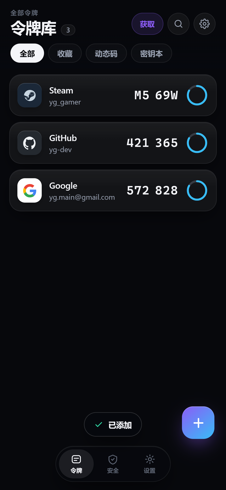
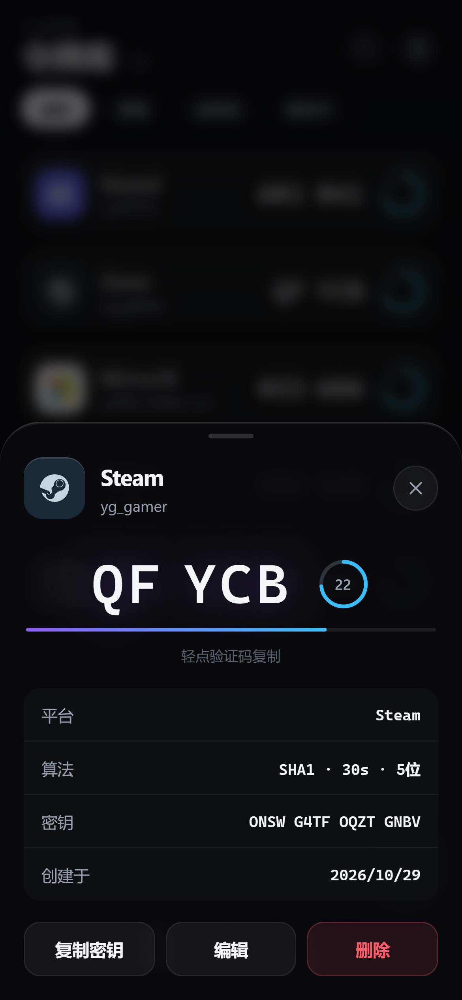
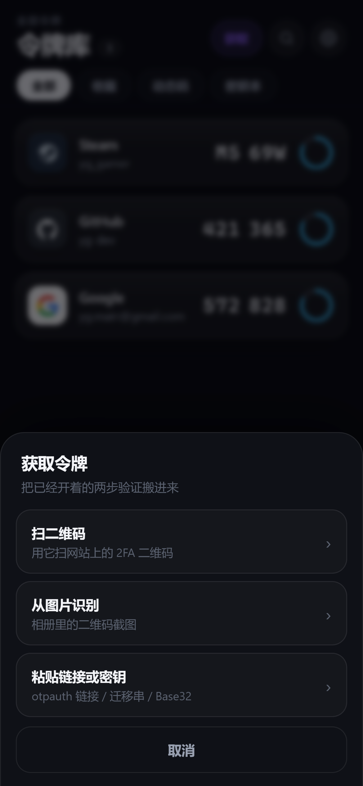

</div>

---

## 目录

- [一、三种用法](#一三种用法)
- [二、界面](#二界面)
- [三、功能](#三功能)
- [四、怎么把已有令牌搬进来](#四怎么把已有令牌搬进来)
- [五、支持的平台](#五支持的平台)
- [六、安全设计](#六安全设计)
- [七、常见问题](#七常见问题)
- [八、自检与开发](#八自检与开发)
- [九、目录结构](#九目录结构)

---

## 一、三种用法

| 方式 | 地址 / 文件 | 大小 | 适合 |
| --- | --- | --- | --- |
| **① 在线网页版** | <https://andhirtion.github.io/TokenVault/> | 0 安装 | **手机浏览器打开就用**，菜单里「添加到主屏幕」就像个 App，断网也能出码 |
| **② 安卓 App** | [TokenVault-1.1.3.apk](https://github.com/andhirtion/TokenVault/releases/download/v1.1.3/TokenVault-1.1.3.apk) | 2.3 MB | 想要原生体验（真机相机扫码、内置浏览器抓密钥） |
| **③ 本地跑源码** | [`web/`](web/) 或 [`android/`](android/) | — | 想改代码 |

### ① 在线网页版（最快，推荐先试这个）

手机或电脑浏览器打开 <https://andhirtion.github.io/TokenVault/>：

1. 首次进入设置 6 位 PIN → 再输一次确认；
2. 点右下角 **＋** 手动加令牌，或点右上角 **「获取」** 从二维码/图片/剪贴板导入；
3. 浏览器菜单 →「添加到主屏幕 / 安装应用」，之后全屏打开、离线可用。

> 令牌加密后存在**你浏览器的 IndexedDB** 里，GitHub Pages 只托管静态文件，
> 没有任何后端接口，密钥和验证码都不会离开设备。

### ② 安卓 App

| 文件 | 大小 | 说明 |
| --- | --- | --- |
| [TokenVault-1.1.3.apk](https://github.com/andhirtion/TokenVault/releases/download/v1.1.3/TokenVault-1.1.3.apk) | 2.3 MB | 正式包，包名 `com.yg.tokenvault`，R8 混淆 |
| [TokenVault-1.1.3-debug.apk](https://github.com/andhirtion/TokenVault/releases/download/v1.1.3/TokenVault-1.1.3-debug.apk) | 20 MB | 未混淆版，正式包万一闪退就换它 |

传到手机 → 点开 → 允许「安装未知来源应用」→ 装完打开。
（全部版本见 [Releases](https://github.com/andhirtion/TokenVault/releases)。）

- 要求 **Android 8.0（API 26）** 及以上
- debug 证书签名，上不了 Play 商店，自己用没问题
- 装之前先联网同步一次系统时间 —— TOTP 严格依赖时间

### ③ 本地跑源码

```bash
cd TokenVault
python tools/serve.py 8777     # 必须是它，不能用 python -m http.server（原因见下）
```

打开 <http://127.0.0.1:8777/index.html>，手机连同一 WiFi 用 `http://<电脑IP>:8777/index.html`。

> Windows 注册表常把 `.js` 映射成 `text/plain`，Service Worker 会因此注册失败、离线缓存失效
> （控制台报 `unsupported MIME type ('text/plain')`）。`tools/serve.py` 强制返回
> `text/javascript` 并加了 `Service-Worker-Allowed: /`。

安卓端：

```bash
bash tools/build_apk.sh            # debug 包
bash tools/build_apk.sh release    # 正式包
bash tools/build_apk.sh test       # 跑 30 项 JVM 单元测试
```

`.toolchain/` 已备好 **JDK 17 + Android SDK Platform 35 + Build-Tools 35.0.0 + Gradle 8.11.1**，
脚本自己设 `JAVA_HOME` / `ANDROID_HOME` / `GRADLE_USER_HOME` / 临时目录，不污染系统。
国内 `dl.google.com` 常不通，所以 `settings.gradle.kts` 把**阿里云 Maven 镜像排在官方源前面**。

---

## 二、界面

<div align="center">

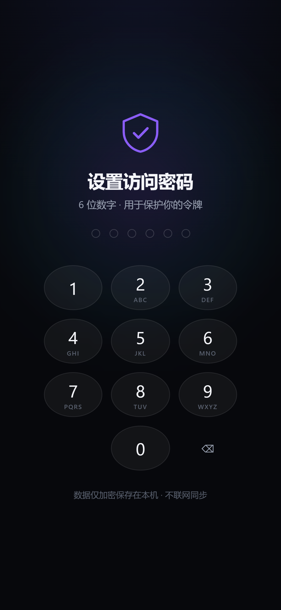
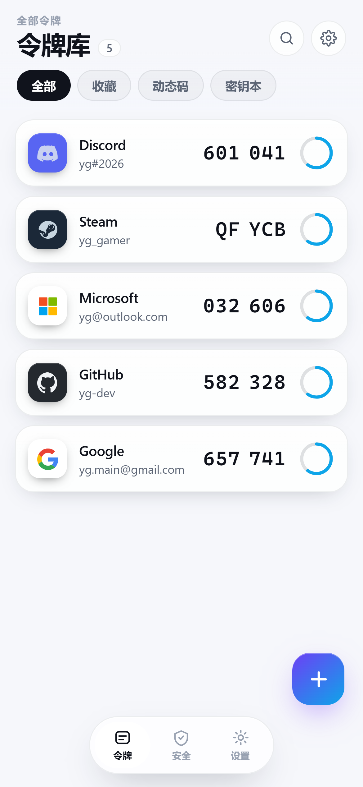
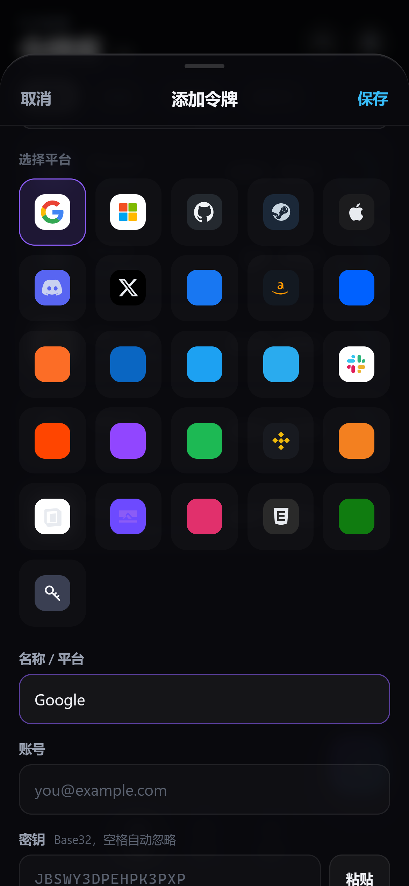
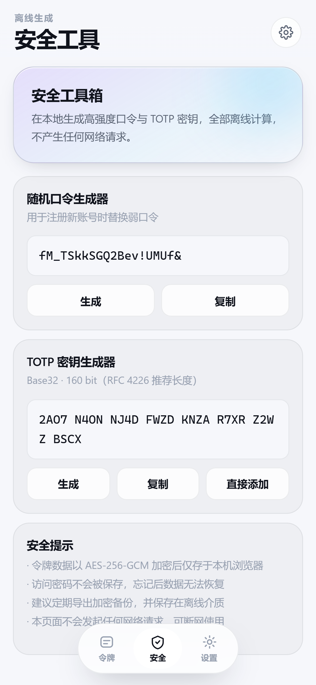

<sub>PIN 锁屏 · 浅色主题 · 令牌编辑器 · 安全工具（随机口令 / Base32 生成 / 验证码试算）</sub>

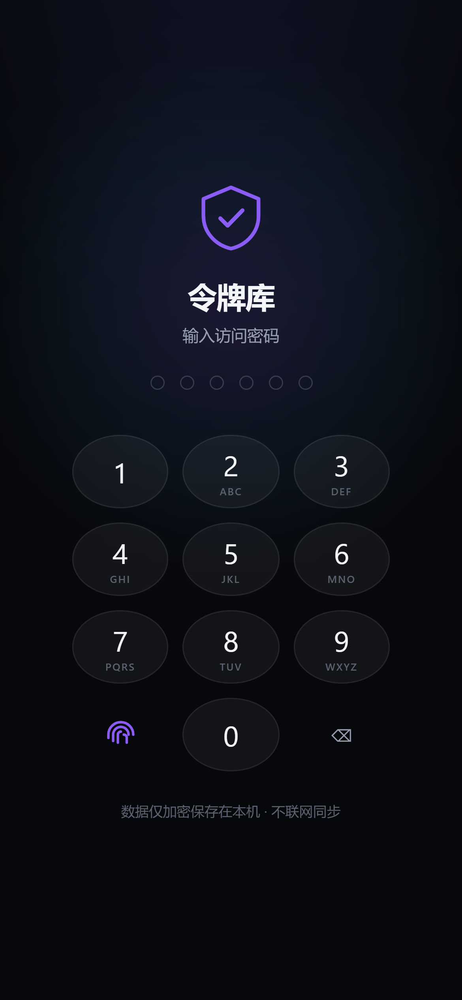
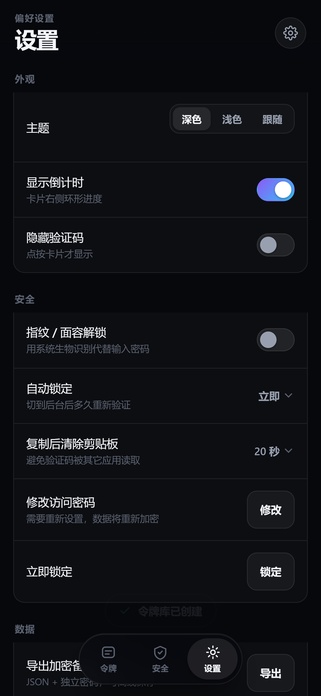
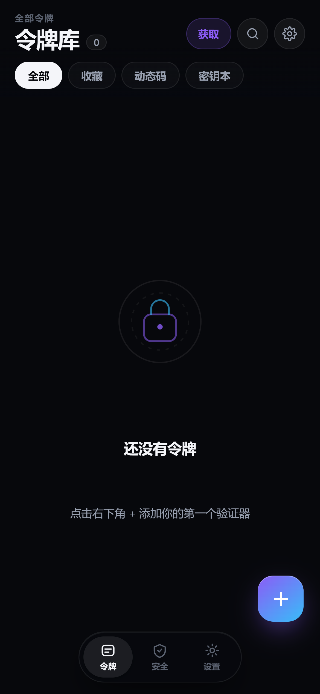

<sub>锁屏左下多出指纹键 · 设置里开启「指纹 / 面容解锁」· 指纹验证后直接进入</sub>

</div>

- 深色为默认（`#07080c` 底 + 紫青渐变），可切浅色或跟随系统
- 品牌图标 26 套，全是手写内联 SVG / VectorDrawable，**不加载任何网络图片**
- 环形倒计时，剩 5 秒变红；点验证码即复制，可设 15/30/60 秒后自动清剪贴板
- 长按卡片收藏，收藏置顶分组
- **指纹 / 面容解锁**：设置里开启后锁屏左下会出现指纹键，按一下就进（安卓走 `BiometricPrompt`，网页走 WebAuthn）
- 「隐藏验证码」模式：列表只显圆点，点开详情才显示
- 搜索（名称 / 账号 / 备注）+ 平台筛选

---

## 三、功能

**令牌**
- 26 个平台品牌图标与配色，标准 TOTP（SHA-1/256/512，6/8 位，周期可改）
- **Steam Guard 专用 5 位字母码**算法（`23456789BCDFGHJKMNPQRTVWXY`）
- 环形倒计时 + 进度条、剩余时间提示
- 复制验证码、自动清剪贴板
- 收藏、分组、搜索、筛选、隐藏验证码

**获取密钥**（网页版与安卓版都有）
- 相机扫码：对着 `otpauth://` 二维码即入库
- 相册 / 图片识别：截图也能读，纯本地解码
- 剪贴板粘贴：`otpauth://`、`otpauth-migration://`、裸 Base32 都认
- **Google Authenticator 迁移串原生解析**（手写 protobuf，无第三方库），一条链接导入全部账号
- 安卓独有：内置浏览器登录平台 2FA 设置页，自动抓页面里的 otpauth 链接 / 密钥文本 / 二维码图片
  （内置站点含 Google、Microsoft、GitHub、Steam、Dropbox、Amazon、Epic、Discord、**Telegram 网页版**、X）
- 安卓独有：浏览器里点 `otpauth://` 链接直接跳进 App 导入

**安全**
- **指纹 / 面容解锁（当 PIN 用）**：验证一次系统生物识别就直接进入，不用输 PIN
- PIN 经 **PBKDF2-HMAC-SHA256（250,000 次迭代）** 派生 256 位密钥
- 令牌用 **AES-256-GCM** 加密落盘（认证加密，密文被改即解不开）
- 换 PIN 重新生成随机盐、整体重加密
- 自动锁定（1/3/5 分钟，切后台开始计时）、立即锁定清空内存密钥
- 系统备份 / 设备迁移全部排除，密钥不会被云备份带走
- **令牌从不上传**：无服务端，加密解密与验证码计算全在本机

**数据**
- 导出 AES-256-GCM 加密备份（独立密码，可放网盘）
- 导入加密备份，或一批 `otpauth://` 文本批量导入

**工具页**
- 随机口令生成器（8–48 位，大小写 / 数字 / 符号开关）
- Base32 密钥生成（给其它验证器用）
- 验证码试算（不保存，临时核对某密钥算得对不对）

---

## 四、怎么把已有令牌搬进来

点列表页右上角 **「获取」**（或工具箱第一张卡）：

<div align="center">

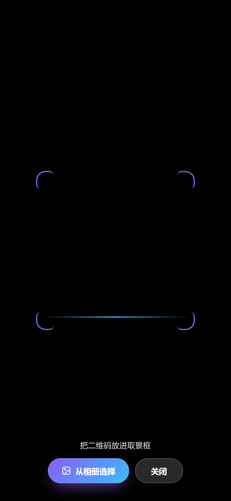
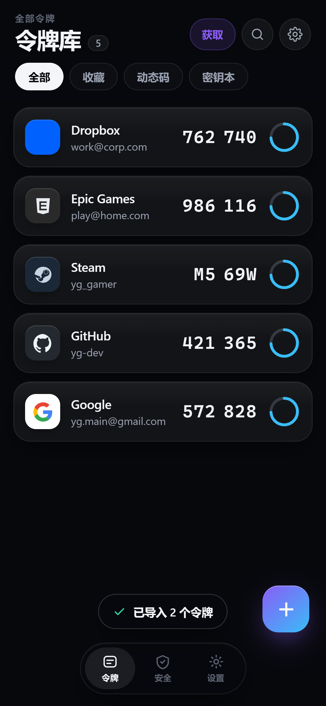
</div>

| 方式 | 适用场景 | 怎么做 |
| --- | --- | --- |
| **扫二维码** | 正在给某账号开启两步验证 | 网站显示二维码时对准它，一秒入库，平台 / 账号 / 参数全自动填好。**扫码界面底部还有「从相册选择」**，懒得多点一步就直接从截图选 |
| **从图片识别** | 二维码已经截图存相册 | 选图片，本地解码，不传任何图像 |
| **粘贴链接或密钥** | 手上有 `otpauth://` 链接 / 迁移串 / Base32 | 复制后点这一项，自动拆出平台、账号、算法、位数、周期 |
| **登录账号自动获取**（安卓） | 想让 App 自己抓回来 | 选平台（Google / 微软 / GitHub / Steam / Dropbox / Amazon / Epic / Discord），在内置浏览器里正常登录走到 2FA 设置页，页面上的二维码和密钥文本会被自动识别，底部出现「已捕获 N 条密钥 → 全部导入」 |

> **为什么不能"事后读回"已经开着的 2FA 密钥？**
> 这是各平台自己的限制：Google / 微软 / GitHub 的安全设置里只会显示「已开启」，密钥在开启那一刻
> 之后就不再展示（GitHub 只在 setup 页给一次 secret；Steam 要走官方手机令牌流程）。
> 任何验证器（含 Authy、1Password）都拿不到「事后读取」，只能在那一次 setup 时把二维码/密钥抄下来。
> 本应用做的是把这一步省到最少：**扫码，或在 App 内登录后自动抓**。

### 方式 A：Base32 密钥（最通用）

在 Google / GitHub / 微软等安全设置里开启两步验证，选「无法扫描二维码」，网站会给你一串
Base32 密钥（形如 `JBSW Y3DP EHPK 3PXP`）。点 ＋ → 选平台 → 粘进「密钥」框（空格、连字符自动清理）→ 保存。

### 方式 B：otpauth 链接

形如 `otpauth://totp/GitHub:me@mail.com?secret=XXXX&issuer=GitHub&digits=6&period=30`
的链接可以粘进来批量导入（多行也行）。安卓版还注册了 `otpauth` 与 `otpauth-migration`
两个 scheme，浏览器里点这种链接会直接跳进 App。

### 方式 C：从别的验证器迁移

Google Authenticator「导出账号」生成
`otpauth-migration://offline?data=<base64>`，本应用**原生解析这个 protobuf**，一条链接导入全部令牌
（含 issuer、账号、算法、位数）。Authy / Aegis / 2FAS 支持导出明文 `otpauth://` 列表的，直接粘贴也行。

> Steam 密钥通过 Steam 手机令牌的「添加验证器」流程给出。Steam 用 5 位字母码，
> 本应用自动按 Steam 规则生成，不需要改任何参数。

---

## 五、支持的平台

Google · Microsoft · GitHub · **Steam** · Apple · Discord · X (Twitter) · Amazon · Dropbox ·
Facebook · GitLab · LinkedIn · Slack · Telegram · Reddit · Twitch · Spotify · Binance ·
Cloudflare · Notion · Proton · Epic Games · Instagram · Xbox · Twitter · 自定义

平台识别带别名表：`Gmail` → Google、`Outlook/Hotmail/Office 365/Azure` → Microsoft、
`iCloud` → Apple、`AWS` → Amazon、`Epic Games` → Epic、`Xbox Live` → Xbox、
`t.me / web.telegram.org` → **Telegram**（频道与网页版登录都归到同一个平台）。
不认识的 issuer 一律落到「自定义」，照样能出码。

---

## 六、安全设计

| 环节 | 做法 |
| --- | --- |
| 密钥派生 | PBKDF2-HMAC-SHA256，250,000 次迭代，随机 32 字节盐 |
| 加密 | AES-256-GCM，96 位随机 IV，128 位认证标签 |
| 存储 | Web：IndexedDB；安卓：SharedPreferences（两者都只存密文） |
| 换 PIN | 新盐 + 全量重加密 |
| 备份 | 独立密码再加密一次，明文永不落盘 |
| 系统备份 | 安卓 `allowBackup=false` + `dataExtractionRules` 全排除 |
| 生物解锁 | 安卓 `AndroidKeyStore` 里一把「每次使用都需认证」的 AES-256-GCM 密钥封住 PIN（`setUserAuthenticationRequired` + `setInvalidatedByBiometricEnrollment`），密钥不出安全区；网页版走 WebAuthn platform authenticator，支持 PRF 时包裹密钥不落盘，不支持时用本机随机密钥包裹（属于便利层，等价于把 PIN 加密存本机） |
| 网络 | Web 版零请求；安卓 `INTERNET` 权限只服务于内置浏览器登录页，代码里没有任何上传逻辑 |

**没有找回通道。** 忘了 PIN 只能靠之前导出的加密备份 —— 能找回就等于别人也能找回。

---

## 七、常见问题

**验证码一直不对？**
1. 系统时间有没有自动同步（TOTP 误差超过 30 秒必错）；
2. 密钥有没有抄漏 —— 本应用会把 `0` 当 `O`、`1` 当 `L` 容错，但漏字符救不了；
3. 平台选错没有（Steam 必须选 Steam，普通 6 位算法算不出它的 5 位码）。

**换手机怎么办？**
设置 → 导出加密备份，把文本存网盘；新机导入。别指望系统备份 —— 本应用主动排除了它。

**忘了 PIN？**
只能靠加密备份恢复。请务必先导出一份。

**能不能云端同步？**
不做。令牌不上云，只能手动导出 / 导入加密备份。

**网页版扫码没反应？**
`BarcodeDetector` 只有 Chrome / Edge 新版和部分 Safari 支持。不支持时点「扫二维码」会自动改为
**从相册选图**；再不行就用「粘贴链接或密钥」。

**「登录账号自动获取」抓不到东西？**（安卓）
1. 要走到 **2FA 设置页**，不是登录页或首页 —— 密钥只在这个页面出现；
2. 平台在已开启状态下只显示「已启用」，不给密钥。只能先移除再重新开启，在重开那一次扫；
3. 抓取每 1.8 秒扫一次页面，页面加载慢就多点几次右上角「抓取」。

**Telegram（网页版 / 频道）怎么存？**
Telegram 的两步验证是**自设密码**，不是 TOTP 动态码，所以没有二维码可扫。做法是：
新建一条 **「笔记」类型**条目 → 平台选 Telegram → 账号填手机号或 `@频道名` → 备注里写两步验证密码 / 恢复邮箱 / 备用码。
如果你自己的某个服务（如自建的 Telegram Bot 面板）给了 TOTP 二维码，照常扫码即入库，平台会自动归到 Telegram。
安卓版「获取密钥 → 登录网页」里已内置 `web.telegram.org`，可直接在里面登录。

---

## 八、自检与开发

```bash
node tools/verify.js             # Web 版算法（30 项）
node tools/verify_web_import.js  # Web 版「获取令牌」解析层（39 项）
bash tools/build_apk.sh test     # 安卓版（30 项 JVM 单元测试）
```

| 覆盖项 | Web 算法 | Web 导入 | 安卓 |
| --- | :---: | :---: | :---: |
| RFC 6238 SHA-1 六组官方向量 | ✅ | — | ✅ |
| RFC 6238 SHA-256 / SHA-512 | ✅ | ✅ | ✅ |
| 6 位 / 8 位 / 前导零补位 | ✅ | — | ✅ |
| Steam 5 位字母码字符集 | ✅ | ✅ | ✅ |
| Base32 容错（大小写/空格/0→O/1→L） | ✅ | ✅ | ✅ |
| 过短密钥拒绝 | ✅ | ✅ | ✅ |
| 剩余时间与进度 | ✅ | — | ✅ |
| `otpauth://` 解析（Google/GitHub/Steam/自定义） | ✅ | ✅ | ✅ |
| `otpauth-migration://` protobuf（多账号/SHA256/8 位/跳过 HOTP） | — | ✅ | ✅ |
| 混合文本识别与按 secret 去重 | — | ✅ | ✅ |
| HTML 实体反转义、垃圾文本拒绝 | — | ✅ | ✅ |
| 平台别名识别、单字符 key 不误判 | — | ✅ | ✅ |
| 26 平台默认参数合法性 | — | ✅ | ✅ |
| WebCrypto 与纯 JS 实现交叉验证 | ✅ | — | — |

**当前结果：Web 算法 30 + Web 导入 39 + 安卓 30 = 99 项，全部通过 / 0 失败。**

界面回归（需先起 `python tools/serve.py 8777`，用本机 Edge）：

```bash
python tools/shoot.py        # 锁屏 / 列表 / 详情 / 编辑器 / 设置 / 工具箱 / 浅色
python tools/shoot_grab.py   # 「获取」面板 + 迁移串导入全流程
python tools/shoot_scan.py   # 扫码层（含「从相册选择」，用 fake camera）
```

---

## 九、目录结构

```
TokenVault/
├─ docs/                      # GitHub Pages 发布副本（= web/，改完 cp -r web docs）
├─ dist/                      # 成品 APK
├─ web/                       # PWA，零依赖零构建
│  ├─ index.html
│  ├─ styles.css              # 设计系统：深色 #07080c / 紫青渐变
│  ├─ app.js                  # TOTP 算法 + AES-GCM 保险库 + 导入解析 + 全部交互
│  ├─ sw.js                   # Service Worker，离线优先（缓存版本 v2）
│  ├─ manifest.webmanifest
│  └─ icon.svg
├─ android/
│  ├─ app/src/main/java/com/yg/tokenvault/
│  │  ├─ data/                # Platforms / TokenEntry / Totp / VaultRepository
│  │  │                       # + OtpImporter（统一导入）/ OtpMigration（protobuf 解析）
│  │  ├─ security/            # VaultCrypto（PBKDF2 + AES-GCM）
│  │  ├─ util/                # Base32 / QrDecoder（zxing 封装）
│  │  ├─ ui/theme/            # 配色、字体、深浅主题
│  │  ├─ ui/components/       # BrandTile / TokenCard / RingProgress / PinPad / AppLogo
│  │  ├─ ui/screens/          # Lock / Vault / Editor / Detail / Settings / Tools
│  │  │                       # + ImportSheet（四选一）/ ScanScreen（CameraX 扫码）
│  │  │                       # + LoginScreen（内置浏览器登录抓取）
│  │  ├─ VaultViewModel.kt
│  │  ├─ TokenVaultApp.kt
│  │  └─ MainActivity.kt      # 含 otpauth:// 外链导入
│  ├─ app/src/test/java/com/yg/tokenvault/   # CoreLogicTest 18 项 + OtpImportTest 12 项
│  └─ app/src/main/res/       # 品牌图标、自适应启动图标、字符串、备份排除规则
├─ tools/
│  ├─ serve.py                # 带正确 MIME 的本地服务器
│  ├─ verify.js               # Web 版算法自检
│  ├─ verify_web_import.js    # Web 版导入解析自检（自带 protobuf 编码器）
│  ├─ build_apk.sh            # 一键编译 / 跑测试（自带工具链）
│  ├─ export_icons.py         # 从 web/app.js 的品牌 SVG 生成安卓 VectorDrawable
│  ├─ shoot.py                # 界面截图
│  ├─ shoot_grab.py           # 「获取令牌」流程截图
│  └─ shoot_scan.py           # 扫码层截图（fake camera）
├─ shots/                     # README 与验收用截图
└─ .toolchain/                # 自带 JDK17 + SDK35 + Gradle 8.11.1（不进版本库）
```

---

## 更新日志

**v1.1.3** — 新增**指纹 / 面容解锁**（指纹当 PIN 用）：网页版走 WebAuthn、安卓走 BiometricPrompt + AndroidKeyStore；Telegram 网页版 / 频道链接（`t.me`）加入平台识别与内置登录站点。

**v1.1.2** — 扫码取景层加「从相册选择」（网页版 + 安卓版同步）；网页版摄像头不可用或被拒时自动降级到相册；README 重写并配上 10 张界面截图。

**v1.1.1** — 网页版上线 <https://andhirtion.github.io/TokenVault/>；网页版支持扫码 / 图片 / 粘贴 /
Google 迁移串导入；扫码界面加「从相册选择」；修平台别名与单字符 key 误判；修弹层透光。

**v1.1.0** — 安卓版四条自动获取密钥通道（扫码 / 登录抓取 / 相册 / 剪贴板）、迁移串原生解析、
外链导入、`INTERNET` 权限。

**v1.0.0** — Web PWA + 安卓 App 首发，26 平台、Steam 5 位码、AES-256-GCM 本地保险库。

---

<div align="center">
<sub>Made for people who are tired of pulling out their phone for a 6-digit number.</sub>
</div>