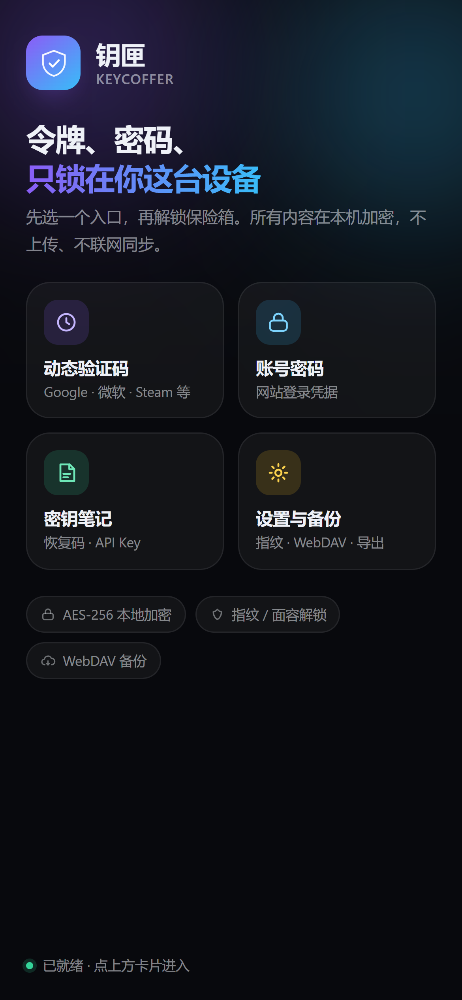
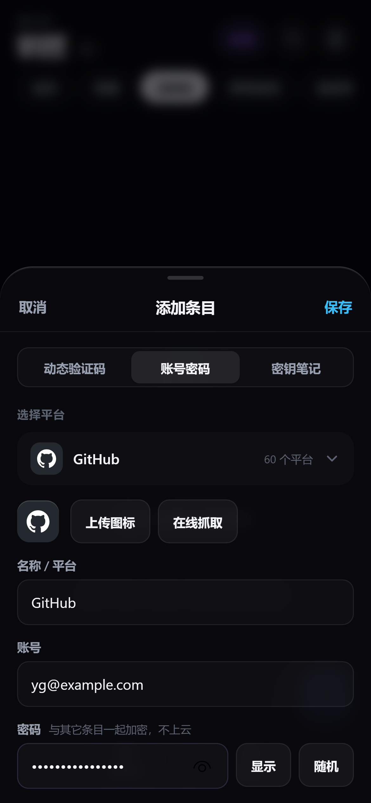
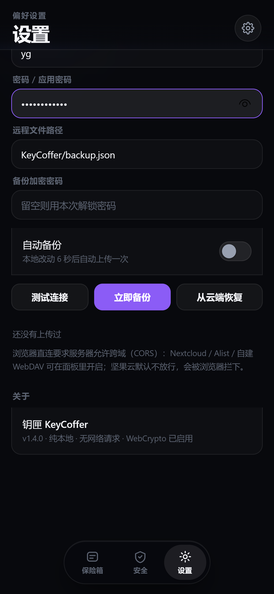
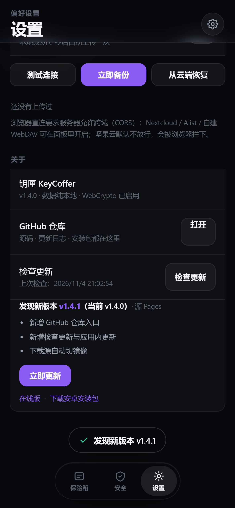
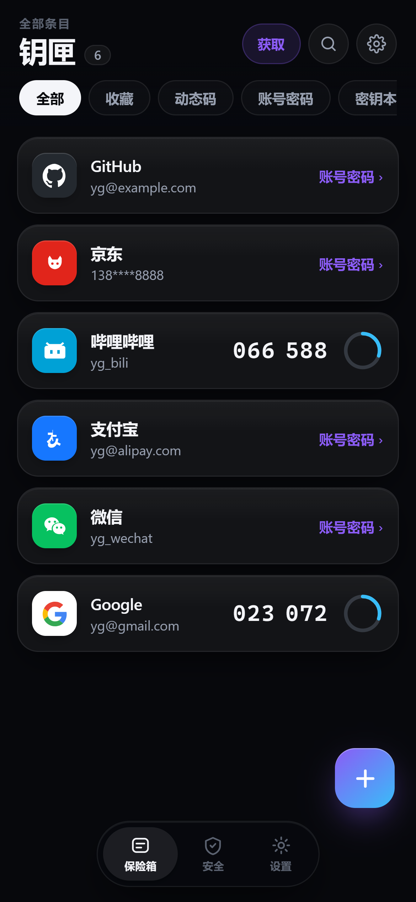
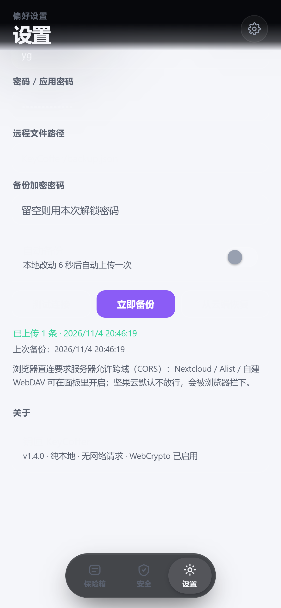
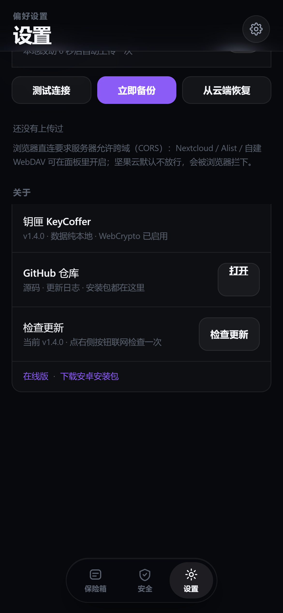

# 钥匣 · KeyCoffer

<div align="center">

**一个本地加密的小保险箱：动态验证码 + 账号密码 + 密钥笔记，全放在一个列表里**

### 👉 [下载 App（v1.5.1 · 2.4 MB）](https://github.com/andhirtion/TokenVault/releases/latest) 👈

安卓 8.0+ · 4 个常用平台 + 自定义 · 主界面先选后进 · 自定义图标与背景 · 指纹解锁 · WebDAV 云备份 · 应用内更新 · AES-256-GCM 本地加密

<br>






<sub>界面示意：与 App 端共用同一套设计语言（深色玻璃卡、紫青渐变、四宫格主界面）</sub>

</div>

---

## 目录

- [一、下载与安装](#一下载与安装)
- [二、界面](#二界面)
- [三、三种条目](#三三种条目)
- [四、功能](#四功能)
- [五、怎么把已有令牌搬进来](#五怎么把已有令牌搬进来)
- [六、支持的平台](#六支持的平台)
- [七、WebDAV 云备份怎么配](#七webdav-云备份怎么配)
- [八、安全设计](#八安全设计)
- [九、常见问题](#九常见问题)
- [十、自己构建](#十自己构建)
- [十一、目录结构](#十一目录结构)
- [更新日志](#更新日志)

---

## 一、下载与安装

| 文件 | 大小 | 说明 |
| --- | --- | --- |
| [TokenVault-1.5.1.apk](https://github.com/andhirtion/TokenVault/releases/download/v1.5.1/TokenVault-1.5.1.apk) | 2.4 MB（2 424 304 字节） | **正式包**，已用固定签名，可直接覆盖安装旧版 |

装不上的话按这个顺序换：

1. **直连慢/失败** → 换镜像：
   - `https://gh-proxy.com/https://github.com/andhirtion/TokenVault/releases/download/v1.5.1/TokenVault-1.5.1.apk`
   - `https://ghfast.top/https://github.com/andhirtion/TokenVault/releases/download/v1.5.1/TokenVault-1.5.1.apk`
   - `https://ghproxy.net/https://github.com/andhirtion/TokenVault/releases/download/v1.5.1/TokenVault-1.5.1.apk`
2. **提示「签名不一致」** → 说明装的是 1.3.0 之前的老包。先设置里导出备份，再卸载重装，然后导入备份。
3. **提示「未安装应用」/被拦截** → 系统设置里允许「安装未知来源应用」，或先用手机上的文件管理器打开一次。

> 包信息：`com.yg.tokenvault` · versionCode 10 · minSdk 26（安卓 8.0）· targetSdk 35 ·
> **不需要 INTERNET 权限也能出码**（联网只用于检查更新、内置浏览器登录、WebDAV 备份这三件事，都由你主动触发）

### 数据在哪

- 全部数据（令牌密钥、账号密码、笔记）用 **AES-256-GCM** 加密后存在 App 私有目录里，密钥由你的 **PIN 经 PBKDF2-SHA256（250 000 次）** 派生；
- 卸载 App 会连数据一起删掉，**升级覆盖安装不会**；
- 需要跨设备/换机就配 WebDAV，或者用设置里的「导出备份」。

---

## 二、界面

打开 App 先看到主界面，四张卡分别进四个地方：

| 卡片 | 里面是什么 |
| --- | --- |
| **令牌** | 动态验证码列表，点条目看大码 + 复制 + 倒计时环 |
| **账号密码** | 账号/密码条目，密码默认打码，点眼睛才显示 |
| **工具箱** | 扫码、从相册识别、粘贴导入、随机密钥/密码生成器 |
| **设置** | 外观（主题/背景）、安全（改 PIN/指纹/自动锁）、数据（WebDAV/导入导出）、关于（仓库/检查更新） |






列表顶部是筛选胶囊（全部 / 收藏 / 账号密码 / 动态码 / 各平台），右上角是搜索与「获取」入口。

---

## 三、三种条目

| 类型 | 用来存 | 列表上显示 |
| --- | --- | --- |
| **动态码** | TOTP 密钥（Base32） | 6 位（Steam 是 5 位）+ 30 秒倒计时环 |
| **账号密码** | 账号、密码、备注 | 账号 + 打码密码，点开可复制 |
| **笔记** | 恢复码、密钥串、助记词之类 | 标题 + 摘要 |

同一个列表里混着放，靠类型标签和筛选区分。

---

## 四、功能

### 动态码

- 标准 **RFC 6238 TOTP**：SHA1 / SHA256 / SHA512，6 位或 8 位，周期 15～120 秒；
- **Steam Guard** 单独适配：5 位、字符表 `23456789BCDFGHJKMNPQRTVWXY`；
- 列表每 30 秒自动刷新，详情页有进度环；
- 长按/点按条目可复制，复制后按设置里的秒数自动清空剪贴板。

### 导入已有令牌（四条通道）

| 通道 | 怎么用 | 支持的内容 |
| --- | --- | --- |
| **扫二维码** | 工具箱 → 扫码，对着电脑屏幕上的二维码 | `otpauth://` 链接、Google Authenticator 迁移码 |
| **从相册选图** | 扫码页底部「从相册选择」，或工具箱 → 从图片识别 | 同上（截图里的二维码也能认） |
| **粘贴 / 剪贴板** | 工具箱 → 粘贴导入，或直接粘一大段文本 | 链接、裸 Base32、混合文本（能一次抓出多条） |
| **内置浏览器登录** | 列表右上角地球图标 → **先到「网页登录」主页**选站点 → 打开目标网站登录 | 页面上出现的 `otpauth://` 或 Base32 密钥会被自动抓出来 |

> Google Authenticator 的「导出账号」生成的是 `otpauth-migration://offline?data=...`，
> 本 App 手写了 protobuf 解析，能一次导入整批账号（HOTP 会跳过）。

### 自定义图标

- 添加/编辑条目时点「上传图片」→ 从相册选 → 自动居中裁成正方形存成 256×256 PNG；
- 或者填了邮箱/域名后点「联网抓取」→ 依次尝试 `站点/favicon.ico` → DuckDuckGo → Google s2，抓到就用；
- 「重置」回到平台内置图标；
- 图标存在 App 私有目录，不进备份明文。

### 自定义背景

设置 → 外观 → 自定义背景 → 选一张图，App 会：

1. 最长边压到 1600px 存成 JPEG（88 质量）；
2. 按屏幕尺寸降采样读取，避免大图 OOM；
3. 上面盖一层半透明遮罩，保证文字可读。

「恢复默认背景」一键清掉。

### 指纹 / 面容解锁

- 用 **AndroidKeyStore** 生成一把需要用户认证才能用的 AES 密钥，把 PIN 包起来；
- 打开 App 时先弹系统生物识别，验过就用包里的 PIN 解密保险箱；
- 设置里还能选「指纹优先」，这样冷启动直接进，不用先输 PIN。

### 检查更新与应用内更新

设置 → 关于：

- **GitHub 仓库**：一键打开源码 / 更新日志 / 安装包；
- **检查更新**：依次尝试 Pages → jsDelivr → raw → gh-proxy → ghfast → GitHub API，谁能通就用谁；
- 有新版本时显示版本号与更新说明，点「立即更新」直接下载 APK，下完自动拉起系统安装器；
- 下载源同样自动切镜像（GitHub 直连 / gh-proxy / ghfast / ghproxy），断一个换下一个；
- 首次安装需要给一次「安装未知应用」权限，之后不再问。

### 工具箱

随机密钥生成（Base32，默认 20 字节）、随机密码生成（可选长度、去易混字符 `lI1O0`）、扫码、相册识别、粘贴导入。

### 其他

主题（跟随系统 / 深色 / 浅色）、隐藏验证码（列表上不显示数字）、倒计时环开关、自动锁时间（1～30 分钟）、剪贴板清空时间（10～120 秒）、改 PIN。

---

## 五、怎么把已有令牌搬进来

### 方式 A：Base32 密钥（最通用）

拿到密钥串（形如 `JBSWY3DPEHPK3PXP`）→ 添加 → 选平台 → 粘贴到「密钥」→ 保存。

### 方式 B：otpauth 链接

`otpauth://totp/GitHub:you@example.com?secret=XXX&issuer=GitHub&digits=6&period=30`

复制整段 → 工具箱 → 粘贴导入，会按 issuer 自动选平台。

### 方式 C：从别的验证器迁移

- **Google Authenticator**：设置 → 转移账号 → 导出 → 得到二维码 → 用本 App 扫码/相册识别；
- **其他 App**：一般都能显示二维码，同上处理。

### 方式 D：账号密码 / 笔记手输

添加时切换类型就行，纯本地保存。

> 各平台的设计就是**不允许事后读回已有 2FA 密钥**：GitHub 只在首次设置时显示一次 secret，
> Google/Microsoft 只显示「已设置」，Steam 需要官方登录 + 手机验证。拿到密钥的唯一时机是**首次绑定那一刻**。

---

## 六、支持的平台

内置 4 个高频平台，其余一律用「自定义」：

| 平台 | 位数 | 周期 | 说明 |
| --- | --- | --- | --- |
| **Google** | 6 | 30s | 含 Gmail / YouTube / Workspace |
| **Microsoft** | 6 | 30s | 含 Outlook / Office 365 / Azure / Xbox |
| **Steam** | 5 | 30s | Steam Guard 专用字符表 |
| **GitHub** | 6 | 30s | 标准 TOTP |
| **自定义** | 6/8 | 30s | 任何其它服务，可传自己的图标 |

为什么要精简：之前的 60 个平台列表选起来要翻半天，而且大部分人是拿它存自己的几个常用账号。
现在想加任何服务都选「自定义」，再传一张图标，视觉上比内置平台还好看。

---

## 七、WebDAV 云备份怎么配

设置 → 数据 → **WebDAV 云备份**。

| 字段 | 填什么 |
| --- | --- |
| 服务器地址 | 完整 WebDAV 根地址，例如坚果云 `https://dav.jianguoyun.com/dav/` |
| 账号 | 你的账号（坚果云是注册邮箱） |
| 应用密码 | **不是登录密码**，是服务商单独生成的「应用密码 / 授权码」 |
| 远端路径 | 备份文件放哪，默认 `KeyCoffer/backup.json`，目录不存在会自动 MKCOL 建 |

三个按钮：

- **测试连接**：发一次 `PROPFIND Depth: 0`，返回 207 就算通；
- **立即备份**：把当前保险箱加密后 `PUT` 上去；
- **恢复**：`GET` 回来解密并合并，同 ID 的条目以云端为准。

### 坚果云（实测通过）

1. 网页版坚果云 → 右上角账户 → 安全选项 → **添加应用** → 生成应用密码；
2. 地址填 `https://dav.jianguoyun.com/dav/`，账号填注册邮箱，密码填刚生成的那串；
3. 测试连接 → 立即备份。

### 备份里有什么

- 上传的是**加密后的载荷**，字段是 `app / version / alg / salt / iv / payload`；
- 服务端只看到一堆密文，看不到条目名、账号、密码；
- 备份密码留空时用当前解锁 PIN，两者一致才能恢复成功。

### 自动备份

打开「自动备份」后，任何增删改都会在 **8 秒防抖**后自动上传一次，不用手动点。

---

## 八、安全设计

| 环节 | 用的什么 |
| --- | --- |
| PIN 派生 | PBKDF2-HMAC-SHA256，**250 000 次**，16 字节随机 salt |
| 数据加密 | AES-256-GCM，每次保存新的 12 字节 IV，认证标签随密文一起存 |
| 密钥存放 | 只在内存里，锁屏即清 |
| 指纹 | AndroidKeyStore AES 密钥 + `setUserAuthenticationRequired(true)`，由系统 TEE 验证 |
| 本地文件 | `files/vault.bin`（密文）、`files/icons/`、`files/background.jpg`，都是 App 私有目录 |
| 联网行为 | 只有三处：检查更新、内置浏览器登录、WebDAV 备份，全部由用户主动触发 |
| 数据外传 | 没有后端、没有统计、没有崩溃上报 |

---

## 九、常见问题

**Q：忘了 PIN 怎么办？**
数据是用 PIN 派生的密钥加密的，忘了就解不开。有备份的话卸载重装 → 建新库 → 导入备份（备份密码要填对）。

**Q：验证码不对？**
先看手机时间是否自动同步（TOTP 依赖系统时间）；再确认周期是 30 还是 60 秒；Steam 必须选 Steam 平台（5 位）。

**Q：指纹用不了？**
先在系统里录指纹/人脸；部分机型锁屏未设置生物识别时 `BiometricPrompt` 不可用，App 会自动退回 PIN。

**Q：升级提示签名不一致？**
说明装的是 1.3.0 之前的老包。导出备份 → 卸载 → 装新版 → 导入备份。1.3.0 之后签名已固定，不会再出现。

**Q：怎么更新？装不上怎么办？**
关于 → 检查更新 → 立即更新；下载完成会拉起系统安装器，首次需要允许「安装未知应用」。若下载失败，会依次换镜像重试。

**Q：能在电脑上用吗？**
1.5.0 起网页版已下线，只保留 App。电脑端可以用任意支持 TOTP 的工具导入同一份备份（备份是标准 AES-GCM 载荷，需要自己解密）。

---

## 十、自己构建

### 环境

- JDK 17
- Android SDK：platform 35 / build-tools 35.0.0
- Gradle 8.11.1（仓库内 `.toolchain/` 自带，不入库）

### 命令

```bash
# Windows PowerShell
$TC = ".toolchain"
$env:JAVA_HOME = "$TC\jdk"
$env:ANDROID_HOME = "$TC\sdk"
$env:GRADLE_USER_HOME = "$TC\gradle-home"

& "$TC\gradle-8.11.1\bin\gradle.bat" --no-daemon -p android `
  "-Dorg.gradle.jvmargs=-Xmx3072m -Djava.io.tmpdir=$TC/tmp/kt" `
  "-Dkotlin.daemon.jvm.options=-Djava.io.tmpdir=$TC/tmp/kt" `
  "-Pkotlin.compiler.execution.strategy=in-process" `
  :app:assembleRelease
```

产物在 `android/app/build/outputs/apk/release/app-release.apk`。

> `-Pkotlin.compiler.execution.strategy=in-process` 在 PowerShell 里必须加引号，
> 否则会被拆成 `Task '.compiler.execution.strategy=in-process' not found`。
> `java.io.tmpdir` 指到工程内目录，是为了避开杀软扫 `%TEMP%` 导致的 `AccessDeniedException`。

### 单测

```bash
& "$TC\gradle-8.11.1\bin\gradle.bat" --no-daemon -p android :app:testReleaseUnitTest
```

共 **51 项**：`CoreLogicTest` 21（TOTP / Base32 / 平台 / 密码生成）、`OtpImportTest` 13（otpauth、migration protobuf、平台猜测）、`UpdaterTest` 17（版本比较、两种版本清单解析、镜像顺序）。

### 签名

`android/keystore/keycoffer.jks`（本地保存，**不入公开仓库**）：
口令 `android`、别名 `androiddebugkey`。`build.gradle.kts` 优先用它，缺失时退回本机 debug 签名。

> ⚠️ 这把 keystore 不能换。换了签名，所有已装用户都得卸载重装。

### 工具脚本

| 脚本 | 作用 |
| --- | --- |
| `tools/build_apk.sh` | 一键出包（设置环境变量后 assembleRelease） |
| `tools/fetch_icons.py` | 从 Simple Icons 拉官方品牌 SVG（CC0） |
| `tools/export_icons.py` | 把内联 SVG 转成 60 个 VectorDrawable |
| `tools/fix_icon_fill.py` | 批量把硬编码 `fill` 改成 `currentColor`，避免单色图标在同色底上隐形 |
| `tools/install_android_sdk.sh` | 用腾讯云镜像手工铺 SDK（dl.google.com 不通时用） |
| `tools/unpack_toolchain.sh` / `unpack_android_sdk.sh` | 解包离线工具链 |

---

## 十一、目录结构

```
TokenVault/
├── android/
│   ├── app/src/main/java/com/yg/tokenvault/
│   │   ├── MainActivity.kt            单 Activity + Compose 入口
│   │   ├── TokenVaultApp.kt           根 Composable：主题、背景层、底部导航、弹层
│   │   ├── VaultViewModel.kt          全部状态与方法（解锁、增删改、导入、WebDAV）
│   │   ├── data/
│   │   │   ├── Platforms.kt           4 个内置平台 + 自定义，别名表
│   │   │   ├── TokenEntry.kt          条目模型（含 iconPath）
│   │   │   ├── Totp.kt                RFC 6238 / Steam 字符表
│   │   │   ├── VaultRepository.kt     密文读写（SharedPreferences + AES-GCM）
│   │   │   ├── OtpImporter.kt         otpauth / 裸 Base32 / 混合文本解析
│   │   │   ├── OtpMigration.kt        otpauth-migration protobuf 解析
│   │   │   └── WebDav.kt              WebDAV 客户端与配置存储
│   │   ├── security/
│   │   │   ├── VaultCrypto.kt         PBKDF2 + AES-GCM
│   │   │   └── BiometricVault.kt      AndroidKeyStore + BiometricPrompt
│   │   ├── update/Updater.kt          多源版本检查 + 下载 + 拉起安装器
│   │   ├── util/
│   │   │   ├── Base32.kt / PasswordGen.kt / QrDecoder.kt
│   │   │   └── IconStore.kt           图标抓取/裁剪、背景图存取
│   │   └── ui/
│   │       ├── components/            BrandTile / TokenCard / PinPad / RingProgress …
│   │       ├── screens/               Home / Vault / Detail / Editor / Scan / Login / Tools / Settings
│   │       └── theme/                 Color / Type / Theme
│   ├── app/src/test/                  CoreLogicTest / OtpImportTest / UpdaterTest（51 项）
│   └── app/src/main/res/drawable/     ic_brand_{google,microsoft,steam,github,custom}.xml
├── docs/version.json                  版本清单（检查更新的首选源）
├── dist/                              打好的 APK（不入库）
├── shots/                             界面截图
└── tools/                             构建与图标脚本
```

---

## 更新日志

### v1.5.1 — 网页登录加一层主页（2026-11-05）

- 顶栏地球按钮不再直接开浏览器：先落到**「网页登录」主页**
- 主页里是 10 个常用站点（Google / Microsoft / GitHub / Steam / Dropbox / Amazon / Epic / Discord / Telegram / X）+ 「其它站点」自己填网址
- 主页顶部说明抓取流程：登录后停在「两步验证 / 身份验证器」页，密钥与二维码会被自动识别
- 自定义网址会自动补 `https://`，键盘用 URI 类型

### v1.5.0 — 专精 App 的大改版（2026-11-04）

- **全新主界面**：打开先看四张卡（令牌 / 账号密码 / 工具箱 / 设置），点哪进哪；底部导航改为 4 项
- **平台精简**：60 个平台压到 4 个（Google / Microsoft / Steam / GitHub）+ 自定义，选起来不再眼花
- **自定义图标闭环**：相册传图（自动居中裁方 256×256）或按邮箱域名联网抓 favicon，支持一键重置
- **自定义背景**：本地图片最长边 1600px 压成 JPEG，按屏幕降采样加载，盖半透明遮罩保可读
- **WebDAV 云备份**：坚果云 / Nextcloud / Alist / 自建，支持测试连接、手动备份、从云端恢复、8 秒防抖自动备份
- **移除网页版**：仓库内 `web/` 已删除，App 端专精；`docs/version.json` 保留，供检查更新使用
- 清理 55 个不再使用的平台图标资源，APK 从 2.44 MB 降到 2.41 MB

### v1.4.0 — 关于页 / 检查更新 / 应用内更新（2026-11-04）

- 设置新增「关于」：GitHub 仓库入口、版本号、检查更新
- 多源版本清单（Pages → jsDelivr → raw → gh-proxy → ghfast → GitHub API）与四镜像下载
- 应用内下载 APK 并拉起系统安装器，首次需授权「安装未知应用」
- 修「签名不一致无法覆盖安装」：固定 keystore，与 1.3.0 同一把
- 补齐 Updater 的 17 项 JVM 单测（累计 50 项）

### v1.3.0 — 平台扩展与折叠选择（2026-11-03）

- 平台扩到 60 个（含 20 个国内），折叠行 + 搜索 + 四分类胶囊
- 修指纹优先：冷启动 LaunchedEffect 首帧读状态，等窗口拿到焦点后弹指纹
- 图标全部改为 `currentColor`，消除同色底隐形问题

### v1.2.0 — 账号密码与更名（2026-11-02）

- 新增「账号密码」与「笔记」两种条目类型
- 更名 **钥匣 KeyCoffer**
- 指纹优先进入（无手势也能弹）

### v1.1.x — 导入链路（2026-10-30）

- 扫码 / 相册识别 / 粘贴 / 内置浏览器登录 四条导入通道
- `otpauth-migration://` protobuf 解析（Google Authenticator 批量导出）
- 修复 WebCrypto 算法名、隐藏层拦截点击、tabbar 宽度三个真 bug

### v1.0.0 — 首个版本（2026-10-29）

- TOTP 生成（RFC 6238 六组官方向量验证）
- PIN 解锁（PBKDF2 + AES-256-GCM）
- 深色玻璃拟态界面
